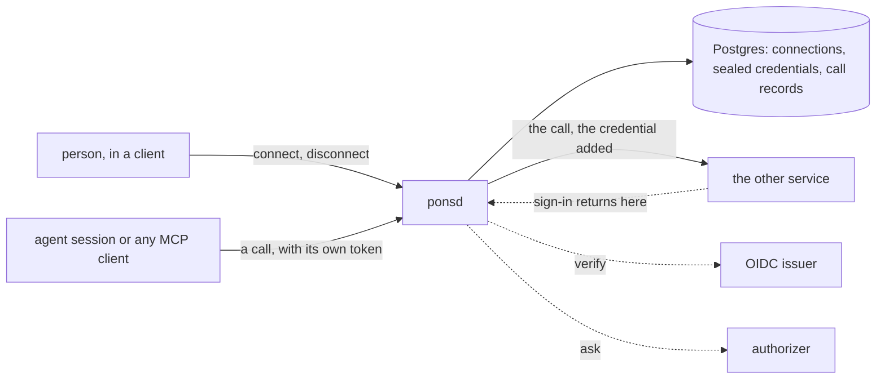

# Pons

**A service that keeps a person's connections to other services and
carries every call to them.** A person connects a service once, by
signing in to it or by pasting a key. Pons seals the credential, keeps
it fresh, and stands between an agent and that service: the agent calls
Pons with its own token, Pons adds the credential and forwards the
call, and the credential never leaves.

What Pons owns is everything between "connect" and the call. It runs
the sign-in with the other service, the way the Model Context Protocol
describes it. It stores each credential sealed under its own key and
refreshes it with one writer, so two callers never spend the same
refresh token. It serves each connection as an address of its own that
any MCP client can use, and it records every call without recording
what was said.

> **Status: design under review.** This repository holds the specs and
> no implementation yet. Start with
> [`specs/001-architecture.md`](specs/001-architecture.md); the index in
> [`specs/README.md`](specs/README.md) lists every spec in build order.

## What it is for

An agent is useful in proportion to what it can reach: a person's
documents, their issue tracker, their mail. Each of those sits behind a
sign-in or a key, and the usual answers are poor. A key pasted into a
conversation has reached a model provider. A token handed to an agent's
sandbox can be read by any code that runs there. A credential store
inside one agent runtime serves that runtime and nothing else.

Pons is the one place that holds such credentials, and the one door
through which they are used. Whatever calls it, an agent's session, a
script, an application, presents a token of its own and receives the
other service's answer. A prompt that tricks an agent can make it call
a tool. It cannot make it reveal a credential it never held.

Pons is that door, and nothing else: it runs no agent, holds no
accounts, and decides no policy. Identity comes from any OpenID Connect
issuer. Who may connect what, and which caller may use which
connection, come from an endpoint the operator writes.

## Shape

## License

Apache-2.0. See [LICENSE](LICENSE).
