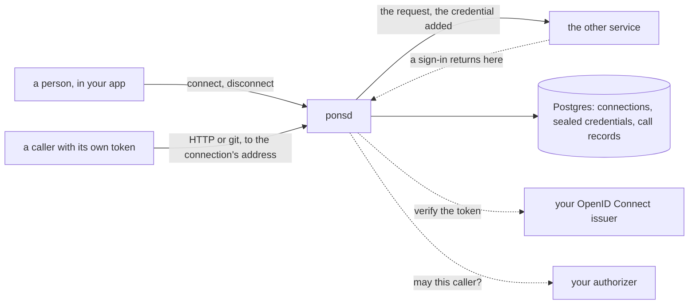

# Pons

**A service that holds people's credentials for other services and
carries every call made with them.** A person connects a service once,
by signing in to it or by pasting a key. Pons seals the credential,
keeps it fresh, and gives the connection addresses of its own. A
caller, such as code in an agent's sandbox, calls those addresses with
its own token: Pons asks whether that caller may make the call, adds the
credential on the way out, and passes the answer back. The credential
never reaches the caller. Identity comes from any OpenID Connect issuer.
Permission comes from an endpoint you write.

This repository is the whole service, `ponsd`, and anyone can run it.

[](https://github.com/latere-ai/pons/actions/workflows/verify.yml)
[](https://github.com/latere-ai/pons/releases)
[](go.mod)
[](LICENSE)

## The problem

An agent is useful in proportion to what it can reach: a person's
repositories, their issue tracker, their documents. Each of those sits
behind a sign-in or a key, and the usual answers are poor. A key pasted
into a conversation has reached a model provider. A token handed to an
agent's sandbox can be read by any code that runs there. A credential
store inside one agent runtime serves that runtime and nothing else.

Pons is one place that holds such credentials, and one door through
which they are used. Whatever calls it, an agent's session, a script or
an application, presents a token of its own and receives the other
service's answer. A prompt that tricks an agent can make it send a
request. It cannot make it reveal a credential it never held.

Pons runs no agent, holds no accounts and decides no policy. Who may
connect what, and which caller may use which connection, is answered by
your authorizer, or by a built-in owner policy when you have none.



## A connection, end to end

The operator writes a catalog: one entry per service the installation
offers. This one is an API with a git host beside it, connected by
pasting a key:

```yaml
connectors:
  - name: forge
    title: Example Forge
    description: Clone and push your repositories, and call the API.
    kind: http
    url: https://api.forge.example.com
    git: {url: https://forge.example.com}
    hosts: ["api.forge.example.com", "forge.example.com"]
    auth:
      type: token
      hint: Create a key under Settings, Access keys.
```

`ponsd` reads it at start:

```sh
PONS_PUBLIC_URL=http://localhost:8080 \
PONS_OIDC_ISSUERS=https://login.example.com \
PONS_SEALING_KEYS="$(openssl rand -base64 32)" \
PONS_CATALOG_FILE=catalog.yaml \
  ponsd serve
```

Every request carries a token from that issuer, addressed to the
audience `pons`. A person connects by pasting their key, which Pons
tries against the service once, seals, and never returns. The answer is
the connection, abridged here:

```sh
curl -s http://localhost:8080/v1/connections \
  -H "Authorization: Bearer $TOKEN" \
  -d '{"connector": "forge", "credential": {"value": "your-forge-key"}}'
```

```json
{
  "id": "con_01m4ts0s3y6jb3gj2j8e7pt7sn",
  "connector": "forge",
  "kind": "http",
  "auth": "token",
  "state": "connected",
  "address": "http://localhost:8080/v1/connections/con_01m4ts0s3y6jb3gj2j8e7pt7sn/http",
  "git_address": "http://localhost:8080/v1/connections/con_01m4ts0s3y6jb3gj2j8e7pt7sn/git"
}
```

From then on a caller uses the two addresses with its own token. The
forwarding address carries plain HTTP to the API, and the git address
carries git to the git host. Pons removes the caller's `Authorization`
header and puts the key in its place:

```sh
ADDRESS=http://localhost:8080/v1/connections/con_01m4ts0s3y6jb3gj2j8e7pt7sn/http
GIT_ADDRESS=http://localhost:8080/v1/connections/con_01m4ts0s3y6jb3gj2j8e7pt7sn/git

curl -s "$ADDRESS/repos/acme/app/issues" -H "Authorization: Bearer $TOKEN"
git -c http.extraHeader="Authorization: Bearer $TOKEN" clone "$GIT_ADDRESS/acme/app.git"
```

A service whose people sign in is connected the same way, with a
`return_to` instead of a key. The answer carries an `authorization_url`
to send the person's browser to. The browser comes back to `return_to`
with the connection's id and a one-time code, and your app finishes the
connection:

```sh
curl -s http://localhost:8080/v1/connections \
  -H "Authorization: Bearer $TOKEN" \
  -d '{"connector": "github", "return_to": "https://app.example.com/connected"}'

# the browser returns to https://app.example.com/connected?connection=con_...&code=...
curl -s http://localhost:8080/v1/connections/con_.../confirm \
  -H "Authorization: Bearer $TOKEN" \
  -d '{"code": "the code the browser brought back"}'
```

Every request through an address leaves a call record that says the
call happened, by whom and with what outcome, and never what it said:
`GET /v1/connections/{id}/calls`.

## What works today

| | |
|---|---|
| **GitHub**, through a GitHub App of your own: a person signs in, and a caller clones, fetches and pushes over git and calls the REST API | works, and was checked against github.com |
| **A connector of kind `http`**: any HTTP API, with a git host beside it when the entry names one, through the forwarding and git addresses | works |
| **A pasted key** (`token`) | works; for kind `http` the key is tried against the service before it is kept |
| **Client credentials** (`client_credentials`): the connection holds its owner's client id and secret, and Pons mints a token at use | works |
| **A sign-in** (`oauth`) for a catalog connector, with refresh by one writer across replicas | works |
| **A push held to the branches your authorizer names** | works; a push to another branch is refused before any of it reaches the service, and git prints the rule as the reason |
| **The MCP address** of a connector of kind `mcp`, for Model Context Protocol clients | not built yet. Such a connection can be made, and its `address` answers `404` |
| **A connector a person adds by its address** | partly. One that takes a key or no credential can be added and connected; one whose people sign in is refused with `422 sign_in_unsupported`. It is of kind `mcp` alone, so it cannot be called until the MCP address exists |
| **Kubernetes manifests** | not in the repository yet; [Install](docs/install.md) lists what a deployment needs |

## Try it

[Running it locally](docs/local.md) starts `ponsd` on your machine with
a local issuer, connects a public service with no credential, and calls
it through both addresses with `curl` and `git`. You need Go 1.27 or
newer to build `ponsd`, and a container runtime for the issuer.

```sh
make build   # out/ponsd
make         # the quality gate
```

## Install it

Every release publishes the image `ghcr.io/latere-ai/ponsd:<tag>` for
linux/amd64 and linux/arm64. [Install](docs/install.md) covers the
image, Postgres and its pooler, the sealing keys and their rotation,
the probes, and `ponsd check`. You supply an OpenID Connect issuer,
a public https address, and, for anything that should survive a
restart, Postgres and a sealing key. An authorizer and a catalog are
optional.

## Documentation

| | |
|---|---|
| [Running it locally](docs/local.md) | `ponsd` on your machine with a local issuer, a connection, and a call through each address |
| [Install](docs/install.md) | the image, Postgres, sealing keys and rotation, the probes, and `ponsd check` |
| [Configuration](docs/configuration.md) | every `PONS_*` variable, its default, and what refuses a start |
| [The catalog](docs/catalog.md) | every member of an entry, each way to give access, and the GitHub entry |
| [API](docs/api.md) | connecting, reconnecting, disconnecting, call records, the addresses, and the errors to branch on |
| [Writing an authorizer](docs/authorizer.md) | the question Pons asks, the vocabulary, the limits an allow carries, and the owner policy |
| [Security](docs/security.md) | what Pons guarantees, and what it does not |

[`docs/README.md`](docs/README.md) is the index, and
[`api/openapi.yaml`](api/openapi.yaml) is the full API reference.

## Contributing

[`CONTRIBUTING.md`](CONTRIBUTING.md) is how to build and test a change
and where code belongs. [`SECURITY.md`](SECURITY.md) is what the
project protects and where to report a vulnerability; please do not
open an issue for one.

## License

Apache-2.0. See [LICENSE](LICENSE).
