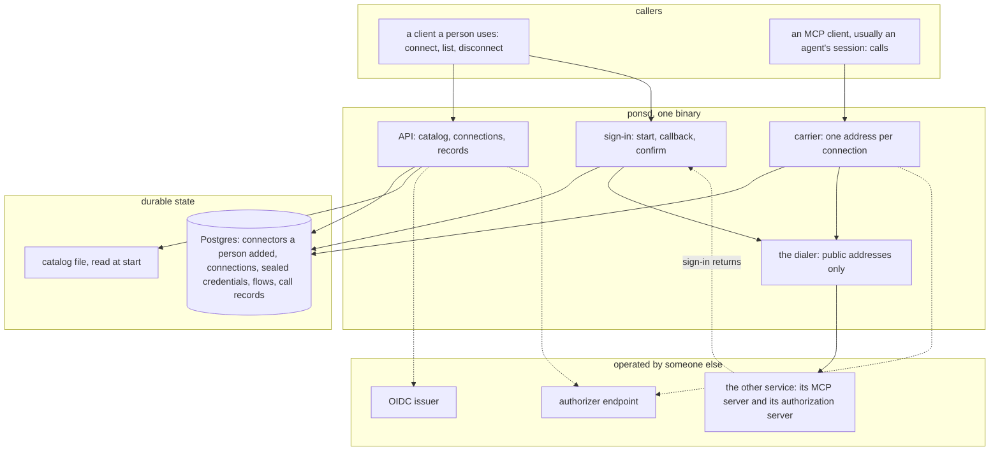

# Architecture

## Overview

Pons keeps a person's connections to other services and carries every
call to them. A person connects a service once, by signing in to it or
by pasting a key. From then on a caller, usually an agent's session,
reaches that service through Pons: it presents a token of its own,
Pons adds the service's credential and forwards the call. The
credential is sealed at rest, used inside Pons, and sent only to the
service it belongs to.

Pons runs no agent and decides no policy. It owns everything between
"connect" and the call: the catalog of services, the sign-in with each,
the sealed credential and its refresh, the address a caller uses, and a
record of each call.

This spec fixes the components, the boundaries between them, and the
invariants every other spec assumes.

## Current state

Built; see Implementation status.

Three designs in sibling projects are the precedent, and each spec says
under this heading what it takes from them. A model gateway seals each
provider's credential under its own key and opens it only to forward a
call, which is the custody Pons follows. A sandbox control plane swaps
a placeholder for a secret at an egress gateway, toward the hosts the
secret's owner named, which is where the rule "a credential is bound to
its hosts" comes from. An identity provider carried a connector for one
code host, with a token per person and a sealed refresh token: one
hand-built case of what Pons does for every service.

## Design

### Components

- **`ponsd`** is one binary. Replicas are interchangeable and
  coordinate only through Postgres. No replica is a leader. A process
  keeps nothing a restart may not lose but a cache of verified keys,
  authorizer answers and opened access tokens.
- **Postgres** holds every fact that must survive a process: the
  connectors a person added, connections, credentials as ciphertext,
  sign-in flows in progress, and call records
  ([[005-store-and-sealing]]). With no database configured `ponsd` runs
  on a store in memory, for development and tests, and says so at
  start.
- **The catalog** is a file the operator writes, read at start: the
  connectors this installation offers, each with its address and how a
  person gives access to it ([[006-catalog]]). A person may also add a
  connector of their own by its address, which is stored and is theirs
  alone.
- **The sign-in** is Pons acting as an OAuth client toward the other
  service: it discovers the service's authorization server, identifies
  itself, sends the person there, receives the code at an address of
  its own, and seals the tokens ([[007-sign-in]]). A service that takes
  a key has no sign-in: the key is accepted once and sealed.
- **The carrier** serves each connection as an address. A request to it
  is authenticated and authorized like any other, the credential is
  added, and the request is forwarded to the connector and its answer
  streamed back ([[008-carrying-a-call]]).
- **The dialer** is the only code that opens a connection to an address
  a catalog entry or a person named. It refuses every address that is
  not public, at the moment it connects ([[009-outbound-requests]]). The
  addresses the operator configures, the database, the issuer, the
  authorizer and the telemetry exporter, are reached without that
  check.
- **The issuer and the authorizer** answer who is calling and what the
  caller may do ([[004-identity-and-authorization]]).

### The path of one connection

1. A client, acting for a signed-in person, asks to connect a connector
   ([[003-api]]). Pons verifies the token, asks the authorizer, and
   writes a connection in state `pending` with a flow.
2. For a connector that signs people in, Pons answers with the address
   to open. The person signs in at the other service and agrees. The
   service returns the person's browser to Pons's callback with a code.
   Pons exchanges the code, seals the tokens, and returns the browser to
   the client with a one-time code of its own.
3. The client, still acting for the same person, confirms the
   connection with that code. Only then is the connection `connected`.
   A flow that is never confirmed expires, and its tokens are discarded.
4. For a connector that takes a key, the client sends the key in the
   request of step 1. Pons seals it and the connection is `connected`
   at once.

Step 3 exists because the address of step 2 can be sent to someone
else. Without it, a person who opened a link they were sent would
connect their own account to the sender's connection
([[012-security-and-threat-model]]).

### The path of one call

1. A caller sends a request to a connection's address with its own
   bearer token.
2. Pons verifies the token and asks the authorizer whether this caller
   may use this connection, for the tool the request names when it
   names one.
3. Pons opens the credential. An access token that has expired is
   refreshed first, by one writer per connection.
4. Pons forwards the request to the connector through the dialer, with
   the credential in the place the connector takes it and the caller's
   own token removed, and streams the answer back.
5. Pons writes one record of the call: who, which connection, which
   tool, when, how long and how it ended. Never what was sent or
   answered.

### Invariants

1. **A credential is write-only.** It is accepted once, at a sign-in or
   in a create request, and no route, record, event, log line or error
   returns it or any part of it.
2. **A credential is sealed at rest** under a key only Pons holds, and
   bound to its row, so a ciphertext copied to another row does not
   open ([[005-store-and-sealing]]).
3. **A credential leaves Pons only toward its connector's hosts**, and
   a refresh token or a client secret only toward the token endpoint
   and the revocation endpoint recorded with it; an access token goes to
   that revocation endpoint only to be revoked. No caller is handed one.
   A redirect to another host is followed without it
   ([[009-outbound-requests]]).
4. **One writer refreshes a connection.** Any number of callers may
   use a connection at once, and at most one of them trades its refresh
   token ([[007-sign-in]]).
5. **Pons decides nothing about people.** Whose a connection is, who
   may connect which connector and which caller may use which
   connection are the authorizer's answers. With no authorizer, an
   owner uses their own connections and nobody else's
   ([[004-identity-and-authorization]]).
6. **Every request toward a connector or its authorization server goes
   through the dialer**, which reaches public addresses only. An address a person supplied is never
   trusted to be what it says ([[009-outbound-requests]]).
7. **A connection becomes usable only by its owner's confirmation**,
   given by a caller who may act for the owner and who holds a code
   that reached them through the browser that finished the sign-in
   ([[007-sign-in]]).
8. **What a connector returns is carried, not read.** Pons parses a
   request far enough to name the tool it calls, or the refs a push
   updates, and parses no result for meaning. It adds nothing to an
   answer and follows no instruction in one. The one change it makes is
   to the `Link` and `Location` headers of a forwarded answer, whose
   URLs under the connector come back under Pons's address
   ([[014-http-forwarding]]).
9. **A record says that a call happened, never what it said.** No
   argument and no result is stored or logged
   ([[010-records-and-observability]]).
10. **Nothing in this repository names an installation.** A hostname, a
    tenant or a product appears only as a default or an example.

### What Pons is not

- Not an agent runtime. It gates no tool call by a person's approval
  and keeps no conversation. A caller that wants a person asked before
  a change asks them itself; Pons tells it, per tool, whether the tool
  only reads ([[006-catalog]]).
- Not an identity provider. It issues no token and holds no account.
- Not a registry. The catalog is the operator's file. Pons ranks,
  reviews and publishes nothing.
- Not a place for the other services' data. It stores no result of any
  call.

### Package layout

| Path | Holds |
|---|---|
| `cmd/ponsd/` | the binary: `serve`, `check`, `version` |
| `api/` | the HTTP contract as an OpenAPI document, public |
| `authorizer/` | the action vocabulary and the limits of an allow, public |
| `catalog/` | the catalog file's types and its validation, public |
| `internal/access/` | verification, the authorizer client, the owner policy |
| `internal/store/` | the store interface, the Postgres and memory adapters, sealing |
| `internal/signin/` | discovery, registration, the flow, refresh |
| `internal/carry/` | the carrier: the MCP address and the request it forwards |
| `internal/dial/` | the dialer |
| `internal/httpapi/` | routes, errors, the OpenAPI document served |
| `internal/config/` | configuration, read once into one typed value |
| `internal/id/` | prefixed, time-ordered identifiers |
| `internal/version/` | the build's version, stamped by the linker |
| `test/stubs/` | a stub issuer, authorizer, connector and authorization server |

The public packages import nothing that dials. `internal/dial` is the
only package that opens a connection, the operator client toward the
issuer and the authorizer included, which it builds. The database
driver and the telemetry exporter are the two exceptions, held by a
test over the import graph and the call sites.

## Not in this spec

The objects and their fields ([[002-objects]]); the routes
([[003-api]]); configuration, images and release
([[011-distribution]]); a code host's install step
([[013-github-connector]]); plain HTTP through a connection
([[014-http-forwarding]]).

## Implementation status

Built: the binary and its three commands; the package layout of the
table above; the memory and
the Postgres stores with the first log line naming the one in use; the
dialer, which builds every client, transport and dialer of the module,
the operator client toward the issuer and the authorizer included; the
owner policy and the authorizer client; invariants 1, 2, 5, 6 and 10 for
the routes that exist.

The carrier of the MCP, forwarding and git addresses and the sign-in
with its confirm: invariants 3, 4, 7, 8 and 9 hold for them.

| Criterion | State |
|---|---|
| `TestTwoReplicasShareOneConnection` | held by `TestRefreshHasOneWriter`, which signs in through one replica of one Postgres, calls through both, and sees one refresh; the test of this name is not written |
| `TestNoCredentialLeavesButTowardItsConnector` | written over every route served: a pasted key, issued tokens, a client's secret and a catalog client secret appear in no response, header, log line or database row of either store, and the key and the tokens are found at the stub API they belong to |
| `TestOnlyTheDialerDials` | written, over the call sites that build a client, a transport or a dialer, the one package that takes the operator client, and the imports of an exporter |
| `TestPublicPackagesDialNothing` | written, over call sites and `go list -deps` |
| `TestStoreSelection` | written |

## Acceptance criteria

| Criterion | Test that proves it |
|---|---|
| Two replicas over one database serve the same connection: a connection made through one is used through the other, and a refresh started by one is not started again by the other | `TestTwoReplicasShareOneConnection` in the e2e tier |
| A canary credential planted at a sign-in and at a pasted key appears in no response body, header, record, log line or error of any route | `TestNoCredentialLeavesButTowardItsConnector` |
| No package but `internal/dial` opens a network connection to an address a catalog entry or a person named; the operator client is built inside `internal/dial`, and the database driver and the telemetry exporter are the two listed exceptions | `TestOnlyTheDialerDials`, over `go list -deps` and call sites |
| The public packages `api`, `authorizer` and `catalog` import no package that dials | `TestPublicPackagesDialNothing` |
| With no database configured the server starts on the memory store and says so in its first log line; with one configured and unreachable it does not start | `TestStoreSelection` |
