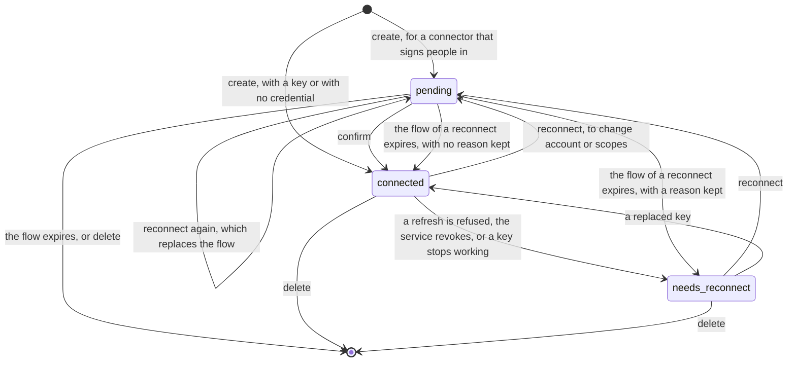

# Objects

## Overview

Six objects carry everything Pons keeps. A connector says what a
service is and how a person gives access to it. A connection is one
owner's link to one connector. A credential is what the other service
issued for that link, and it is never an object a caller reads. A flow
is a sign-in in progress. A registration is what an authorization
server issued to Pons as a client. A call record says that a call
happened. This spec fixes each one's fields, states and identifier, so
the API, the store and the catalog share one description.

## Current state

The first half of the build order is built: the scaffold, identity and the store, the dialer, the catalog and a connection made with a key. See Implementation status.

## Design

### Identifiers

`internal/id` mints prefixed, time-ordered identifiers: a prefix, an
underscore and a ULID in lowercase.

| Object | Prefix | Example |
|---|---|---|
| connection | `con_` | `con_01jb2m6x8q3v7k9n4w5t0zr1ya` |
| connector a person added | `ctr_` | `ctr_01jb2m7c0p5d8f2h6j9k3m4n7q` |
| flow | `flw_` | internal |
| call record | `call_` | `call_01jb2m9s4t6v8x0z2b4d6f8h0k` |

A connector of the catalog is named, not numbered: its `name` is a DNS
label of at most 40 characters. A connector reference is one string: a
catalog name, or the id of a connector a person added. A DNS label
holds no underscore and an id always does, so the two never collide.

A subject is written `<iss>|` everywhere: in `owner`, in
`created_by`, in a record ([[004-identity-and-authorization]]).

### Connector

What a service is. A connector comes from the catalog file or was added
by a person by its address ([[006-catalog]]).

| Field | Type | Meaning |
|---|---|---|
| `name` | DNS label | the catalog name; for an added connector, a label unique among its owner's |
| `id` | `ctr_…` | present on an added connector only |
| `owner` | subject | present on an added connector only: whose it is. Nobody else sees it |
| `title` | string, at most 60 | the name a person reads |
| `description` | string, at most 200 | one sentence on what connecting it gives |
| `icon` | https URL | optional |
| `kind` | `mcp` or `http` | what the address speaks: a Model Context Protocol server, or a plain HTTP API ([[014-http-forwarding]]) |
| `url` | https URL | the server's address, or the API's base |
| `hosts` | list of host patterns | the hosts a credential of this connector may be sent to. Derived from `url` when absent |
| `auth.type` | `oauth`, `token`, `client_credentials`, `none` | how a person gives access |
| `auth` | object | the members of that type ([[006-catalog]]) |
| `tools.read_only` | list of globs | the tools that only read. A tool no glob matches is treated as one that changes something |
| `tools.hidden` | list of globs | tools a caller should not offer |

A connector read through the API never carries a client secret or a
reference to one.

### Connection

One owner's link to one connector.

| Field | Type | Meaning |
|---|---|---|
| `id` | `con_…` | |
| `name` | DNS label | unique among the owner's connections; the connector's name unless the request gives one, so one owner may hold `github` and `github-work` |
| `owner` | subject | whose it is: the owner the authorizer's allow names, or the caller ([[004-identity-and-authorization]]) |
| `connector` | connector reference | fixed at create |
| `kind` | `mcp` or `http` | copied from the connector at create |
| `auth` | `oauth`, `token`, `client_credentials`, `none` | copied from the connector at create |
| `state` | `pending`, `connected`, `needs_reconnect` | below |
| `reason` | string | why the credential stopped working: `refresh_refused`, `revoked` or `credential_refused`. Present in `needs_reconnect`, and in a `pending` connection being reconnected after a refusal |
| `account` | string | the account at the other service this connection acts as, when the service says: a login, an address, a workspace name. Never a secret |
| `scopes` | list of strings | what the other service granted, when it says |
| `address` | URL | where a caller reaches this connection: the MCP address for kind `mcp` ([[008-carrying-a-call]]), the forwarding address for kind `http` ([[014-http-forwarding]]) |
| `git_address` | URL | for kind `http` whose connector names `git.url`: where git reaches the connector's git host ([[014-http-forwarding]]) |
| `tools` | `{read_only, hidden}` | the connector's marks, so a caller applies them by tool name |
| `links` | `{manage}` | links a client may show, copied from the connector when read: `manage` changes what the other service grants ([[013-github-connector]]) |
| `created_by` | subject | who made the request, which differs from `owner` when one acts for another |
| `created_at`, `updated_at` | time | |
| `last_used_at` | time | the last call, written at most once a minute |
| `expires_at` | time | when the credential ends for good, when known: a refresh token's own expiry, or a key's |

A connection in `pending` that had a credential before, because it is
being reconnected, keeps answering calls with the old credential, while
it has no `reason`, until the new one is confirmed. A refusal of that
old credential meanwhile sets its `reason` and leaves it `pending`, so
the confirm still applies. When its flow expires instead, it goes back
to the state it left: `needs_reconnect` when it still has a `reason`,
`connected` otherwise. Only a connection that never had a credential is
deleted when its flow expires. A replaced key, for a `token` or a
`client_credentials` connection, moves one in `needs_reconnect` to
`connected`. A delete removes the credential's ciphertext
in the same transaction and then, where the service offers revocation,
revokes the tokens there, which may fail without failing the delete.

### Credential

What the other service issued. It is stored with its connection and is
no object of the API: no route returns one, lists one or names one.

| Kind | Sealed | Kept in the clear beside it |
|---|---|---|
| `oauth` | the access token and the refresh token | the token type, the access token's expiry, the refresh token's expiry when known, the issuer, the token endpoint and the revocation endpoint recorded at the sign-in, the client id used, the scopes, the `resource` a refresh sends |
| `token` | the value | the header and the format it is placed in |
| `client_credentials` | the client secret | the client id, the token endpoint, the scopes and the audience. The access token it mints is kept in memory only |

A value shorter than 8 bytes is refused, since a canary search cannot
match it safely. Sealing is [[005-store-and-sealing]]'s, and binds the
issuer and the endpoints kept beside a credential into its seal.

### Flow

A sign-in in progress ([[007-sign-in]]). One connection has at most one
live flow, and a new one replaces it.

| Field | Meaning |
|---|---|
| `id` | `flw_…` |
| `connection` | the connection it will make usable |
| `state_hash` | the SHA-256 of the `state` value sent to the other service |
| `verifier` | the proof key's verifier, sealed |
| `issuer`, `authorization_endpoint`, `token_endpoint`, `revocation_endpoint` | recorded from the validated metadata, or the catalog entry, before the person is sent away; the revocation endpoint empty when there is none |
| `iss_parameter_supported` | whether the issuer's metadata sets `authorization_response_iss_parameter_supported` to `true` |
| `client_id`, `redirect_uri`, `resource`, `scopes` | what the request to the other service carried |
| `return_to` | where the browser goes after the callback |
| `pending_credential` | the tokens the callback received, sealed, not yet the connection's |
| `finish_hash` | the SHA-256 of the one-time code handed to the client through the browser |
| `expires_at` | 10 minutes after create; 2 minutes after the callback for the confirm |

### Registration

What an authorization server issued to Pons when Pons registered
itself there dynamically ([[007-sign-in]]). One per issuer and redirect
address: the issuer, the client id, the client secret sealed when one
was issued, and when it was registered. A registration serves catalog
connectors alone: a connector a person added is identified by a client
metadata document of its own, so no consent is shared between
connectors. A client registered by the operator is in the catalog, and
a client metadata document needs no row.

### Call record

That a call happened ([[010-records-and-observability]]).

| Field | Meaning |
|---|---|
| `id` | `call_…` |
| `connection`, `owner`, `connector` | which connection, whose, to what |
| `subject` | the caller's subject |
| `session` | the caller's `session` claim, when its token carries one |
| `at`, `duration_ms` | when, and how long |
| `method` | the protocol method, such as `tools/call`, or the HTTP method for kind `http` |
| `tool` | the tool's name for `tools/call`; the path without its query on a forwarding address; `git-upload-pack` or `git-receive-pack` on a git address |
| `refs` | the count of refs a push updates, on a git address; absent otherwise |
| `effect` | `read` or `write`, by the connector's marks |
| `outcome` | `ok`, `denied`, `not_connected`, `upstream_error`, `upstream_refused`, `timeout`, `canceled` |
| `status` | the connector's HTTP status, when it answered |
| `bytes_in`, `bytes_out` | sizes |

No field holds an argument, a result, a header or a query string.

## Not in this spec

The catalog file's syntax and the members of `auth` ([[006-catalog]]);
the routes that read and write these objects ([[003-api]]); the tables
([[005-store-and-sealing]]).

## Implementation status

Built: the identifiers (`internal/id`); the connector, connection and call
record as the store keeps them and as the API shows them; the credential
as sealed columns with its meta in the clear and the 8-byte floor; flows
and registrations in both stores; the state machine as one Go table both
stores read (`store.Edges`).

A connection of kind `http` carries `git_address` when its connector
names `git.url`, and the carrier moves a connection whose credential the
connector refuses, or keeps a pending one's state and gives it the
reason.

The sign-in moves a connection by its confirm and its reconnect, keeps a
flow per connection with its pending credential, and the sweep returns a
reconnecting connection to the state it left. The account a sign-in read
is kept in the flow's pending meta until the confirm writes it.

| Criterion | State |
|---|---|
| `id.TestPrefixedAndOrdered` | written |
| `catalog.TestNameRules` | written |
| `store.TestConnectionStateMachine` | written, over both stores |
| `TestReconnectKeepsServing` | written |
| `TestDeleteRemovesTheCredentialFirst`, `TestDeleteRevokesBestEffort` | written |
| `api.TestObjectShapes` | written |
| `TestShortCredentialRefused` | written |

## Acceptance criteria

| Criterion | Test that proves it |
|---|---|
| Every identifier is its prefix, an underscore and a lowercase ULID, and ids of one kind sort by creation time | `id.TestPrefixedAndOrdered` |
| A catalog name longer than 40 characters or not a DNS label is refused when the catalog is read, and a reference resolves to a catalog name or to an id and never to both | `catalog.TestNameRules` |
| The connection's state moves only along the edges of the diagram, and every other move is refused by the store | `store.TestConnectionStateMachine`, run against both adapters |
| A connection being reconnected answers calls with its old credential until the new one is confirmed, and with the new one after | `TestReconnectKeepsServing` |
| A delete removes the ciphertext in the transaction that removes the row, and a failed revocation at the service does not fail it | `TestDeleteRemovesTheCredentialFirst`, `TestDeleteRevokesBestEffort` |
| The JSON of a connector, a connection and a call record has exactly the fields of the tables above and no credential member | `api.TestObjectShapes`, against the OpenAPI document |
| A credential value shorter than 8 bytes is refused | `TestShortCredentialRefused` |
