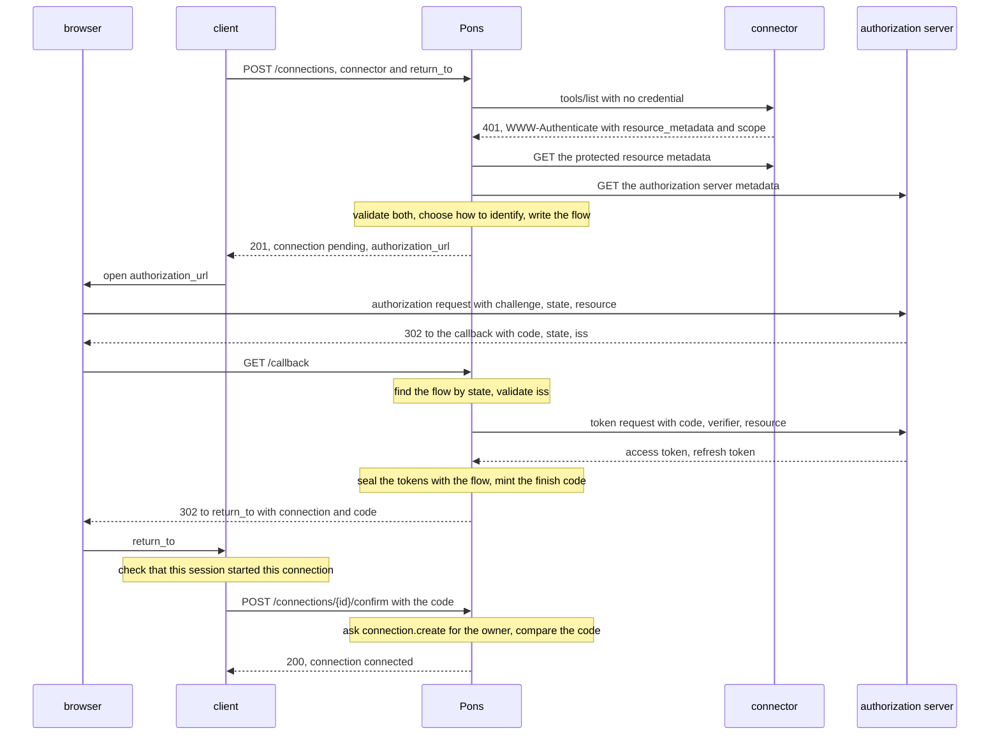
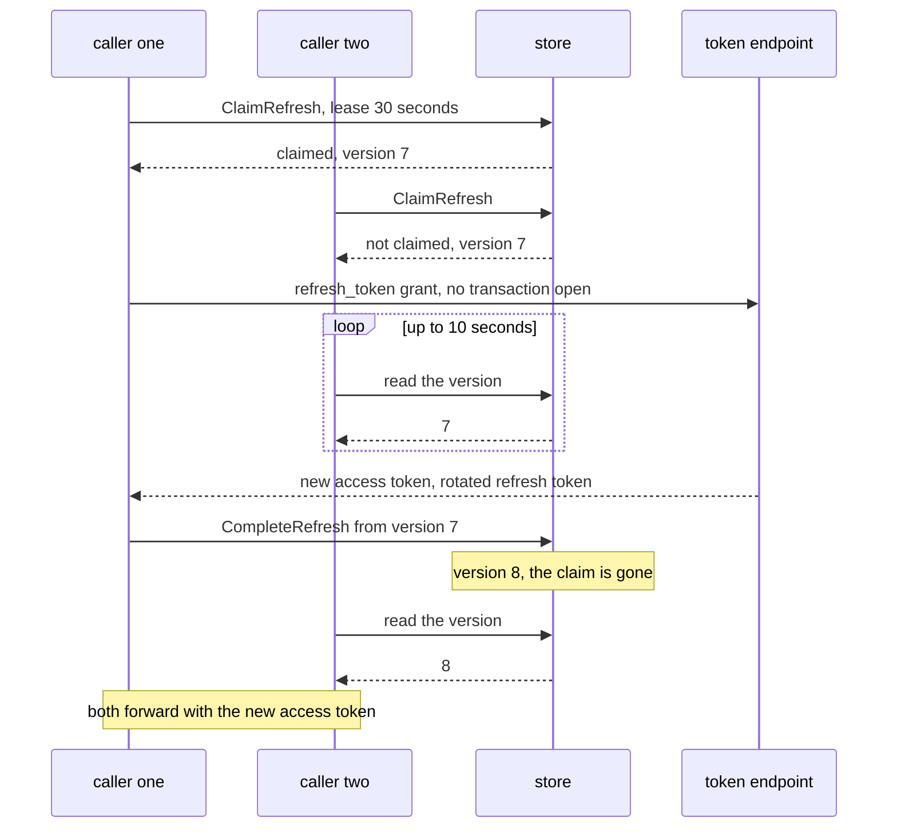

# Sign-in

## Overview

Toward the other service Pons is an OAuth client. It finds the
service's authorization server, identifies itself, sends a person
there, exchanges the code it receives back, and seals the tokens. The
connection becomes usable only when a caller who may act for its owner
confirms it with a code that came back through the browser. Pons keeps
the token fresh with one writer per connection and ends the grant when
the connection is deleted. Protocol statements follow the authorization
part of the Model Context Protocol, revision 2026-07-28, and its RFCs.

## Current state

Built in `internal/signin` for connectors of the catalog; see
Implementation status. An identity provider in a sibling project carried a
connector for one code host, and its shape is taken: a `state` bound to
a stored flow, and a sealed refresh token that never leaves the store.
What is new is that every endpoint is discovered or read from the
catalog, so nothing is written for one service.

## Design

### The whole sign-in



### Discovery

For `discovery: resource` ([[006-catalog]]) Pons learns the
authorization server from the connector, as the protocol has a client
do.

1. **One request with no credential** to `url`: the `tools/list` of
   the probe of [[008-carrying-a-call]] for a connector of kind `mcp`, a
   `GET` of `url` for one of kind `http` ([[014-http-forwarding]]). A
   `401` whose
   `WWW-Authenticate` carries `resource_metadata` names the protected
   resource metadata (RFC 9728, section 5.1). A `scope` in the same
   challenge is kept for the scope selection.
2. **Otherwise the well-known addresses**, with the path of `url`
   inserted and then at the root: for `https://mcp.example.com/public/mcp`,
   `/.well-known/oauth-protected-resource/public/mcp`, then
   `/.well-known/oauth-protected-resource`.
3. **The document is validated.** Its `resource` has the scheme, host
   and port of `url` and a path that is a prefix of the `url`'s at a
   segment boundary, and `authorization_servers` lists https URLs.
4. **The authorization servers are tried in the order listed** (RFC
   9728, section 7.6, leaves the choice to the client). The first that
   passes steps 5 and 6 and gives Pons a way to identify itself is
   taken. An entry that names `issuer` takes that one or none.
5. **Its metadata is fetched** in the protocol's priority order (RFC
   8414, sections 3.1 and 5, and OpenID Connect Discovery 1.0), below.
6. **The metadata is validated before any of it is used.** `issuer` is
   identical to the issuer the address was built from (RFC 8414,
   section 3.3), both endpoints are present, and every endpoint is
   https. A `code_challenge_methods_supported` that is absent or lacks
   `S256` is refused: a client must not proceed without the proof key.

| Issuer | Tried, in order |
|---|---|
| with a path, `https://auth.example.com/tenant1` | `https://auth.example.com/.well-known/oauth-authorization-server/tenant1`, `https://auth.example.com/.well-known/openid-configuration/tenant1`, `https://auth.example.com/tenant1/.well-known/openid-configuration` |
| without one, `https://auth.example.com` | `https://auth.example.com/.well-known/oauth-authorization-server`, `https://auth.example.com/.well-known/openid-configuration` |

A connector or a document that cannot be fetched is `422
connector_unreachable`, and so is a document that names an issuer, an
authorization server or an endpoint the dialer's rules refuse before
resolving it, an address that is not https or whose host is not a name,
with `details.reason` the rule's name ([[009-outbound-requests]]). A
document that was read and cannot be used is `422 sign_in_unsupported`,
with `details.reason` naming the step. Every
fetch goes through the dialer of [[009-outbound-requests]] under its
limits. Discovery runs when a connector is added ([[003-api]]) and at
every connect and reconnect, and nothing of it is cached: a flow
records what it used.

### How Pons identifies itself

In the protocol's priority order:

1. **A client from the catalog** (`auth.client`), when the issuer found
   is the one the entry names. A client is bound to the authorization
   server that issued it, so at another issuer the sign-in is
   `sign_in_unsupported` and the client is not tried there.
2. **A client metadata document**, when the metadata sets
   `client_id_metadata_document_supported` to `true` and
   `PONS_PUBLIC_URL` is https. The client id is the document's own
   address. Catalog connectors share one,
   `{PONS_PUBLIC_URL}{base}/client`, which `GET /client` serves with
   `Cache-Control: public, max-age=3600`:

   ```json
   {
     "client_id": "https://pons.example.com/v1/client",
     "client_name": "Pons",
     "client_uri": "https://www.example.com",
     "redirect_uris": ["https://pons.example.com/v1/callback"],
     "grant_types": ["authorization_code", "refresh_token"],
     "response_types": ["code"],
     "token_endpoint_auth_method": "none"
   }
   ```

   `client_name` is `PONS_CLIENT_NAME`, the name a person reads on the
   service's consent page, and `client_uri` is `PONS_CLIENT_URI`, left
   out when it is unset. A connector a person added has a document of
   its own, `{PONS_PUBLIC_URL}{base}/client/{id}`, which
   `GET /client/{id}` serves the same way, and `404` for an id that
   names no added connector. Its `client_id` is that address and its
   `client_name` is `PONS_CLIENT_NAME`, " for " and the connector's
   title:

   ```json
   {
     "client_id": "https://pons.example.com/v1/client/ctr_01jb2m7c0p5d8f2h6j9k3m4n7q",
     "client_name": "Pons for Team wiki",
     "client_uri": "https://www.example.com",
     "redirect_uris": ["https://pons.example.com/v1/callback"],
     "grant_types": ["authorization_code", "refresh_token"],
     "response_types": ["code"],
     "token_endpoint_auth_method": "none"
   }
   ```

   The consent page then names that connector, and a consent a person
   gave another connector at the same server is not reused for it. This
   document is the only way Pons identifies itself for an added
   connector ([[006-catalog]]).
3. **Dynamic registration** (RFC 7591), for a catalog connector, which
   the protocol deprecates and keeps for servers without the document,
   when the metadata has a `registration_endpoint`. Pons registers the
   shared document's members less `client_id`, plus `application_type`:
   `web`, or `native` when the host of `PONS_PUBLIC_URL` is loopback. The answer is a Registration
   ([[002-objects]]) keyed by issuer and redirect address, its secret
   sealed, reused by later sign-ins at that issuer. Of two replicas
   that register at once the store keeps the first row. One the server
   answers `invalid_client` for is deleted and registered again.
4. **Otherwise `sign_in_unsupported`.** Pons asks no person for a
   client id.

At the token endpoint a client with a secret uses HTTP Basic, and one
without sends `client_id` in the body.

### The authorization request

`POST /connections` and `POST /connections/{id}/reconnect` answer with
`authorization_url`: the validated `authorization_endpoint` with these
members.

| Member | Value |
|---|---|
| `response_type` | `code` |
| `client_id`, `redirect_uri` | as identified above, and `{PONS_PUBLIC_URL}{base}/callback` |
| `code_challenge`, `code_challenge_method` | the SHA-256 of a verifier of 32 random bytes, and `S256`. The verifier is sealed with the flow |
| `state` | 32 random bytes, base64url. Only its SHA-256 is stored, so a copy of the database starts no callback |
| `resource` | the `resource` of the validated protected resource metadata, the server's canonical address (RFC 8707). Sent here and in every token request |
| `scope` | the selection below, omitted when empty |

**Scope selection.** The base is the first of these that exists: the
entry's `scopes`, the `scope` of the challenge of discovery step 1, the
`scopes_supported` of the protected resource metadata. To it are added
the request's `scopes` ([[003-api]]), and `offline_access` when the
authorization server lists it in `scopes_supported`, since Pons wants a
refresh token and may not assume one.

Before the answer leaves, the flow ([[002-objects]]) records all of it
with the validated issuer, the authorization and token endpoints, the
revocation endpoint (the metadata's `revocation_endpoint` or the
entry's `revoke_url`, when there is one), and, as
`iss_parameter_supported`, whether the metadata sets
`authorization_response_iss_parameter_supported` to `true`. The
callback reads the flow and nothing from the network, and the confirm
keeps the issuer and the endpoints with the credential.

### The callback

`GET /callback` needs no token: the other service returns a person's
browser to it.

1. **The flow is found by the SHA-256 of `state`.** No flow is `400`
   with a page saying the link has expired, and no redirect. A flow
   past its time is ended with `error=flow_expired`.
2. **`iss` is validated** before the code is sent anywhere (RFC 9207,
   section 2.4), as the protocol tables it, with its last row narrowed:

   | The metadata says `iss` is sent | `iss` in the answer | Pons |
   |---|---|---|
   | `true` | present | compares it with the recorded issuer |
   | `true` | absent | refuses the answer |
   | `false` or absent | present | compares it with the recorded issuer |
   | `false` or absent | absent | goes on when the catalog names the flow's authorization server, and refuses the answer otherwise |

   The catalog names it when the connection's catalog entry names its
   `issuer`, or gives its endpoints under `discovery: none`. Without
   `iss`, an answer does not say which server issued its code, and
   every server returns to the one callback: a hostile server a person
   added could send the person on to an honest one, and receive at its
   own token endpoint the code the honest one issued, with its verifier
   (RFC 9700, section 4.4). A connector a person adds is therefore
   accepted only when its server says it sends `iss`
   ([[006-catalog]]). A flow whose connector left the catalog is ended
   the same way, with `error=sign_in_failed`.

   The comparison is of strings (RFC 3986, section 6.2.1), with no case
   folding, port, slash or percent normalization after the form
   decoding of the query. On a mismatch the flow is ended, the browser
   goes to `return_to` with `error=sign_in_failed`, and nothing of the
   answer's `error`, `error_description` or `error_uri` is used.
3. **An answer that carries `error`** ends the flow. The browser goes
   to `return_to` with `error=access_denied` when that is the service's
   word, and `error=sign_in_failed` for any other.
4. **The code is exchanged** at the flow's `token_endpoint` with
   `grant_type=authorization_code`, the code, the redirect address, the
   verifier, the `resource` and the client, in 15 seconds. A failure or
   a `token_type` other than `Bearer` ends the flow with
   `error=sign_in_failed`. Every token request, here and at a refresh,
   carries `Accept: application/json`, and an answer whose JSON has an
   `error` member is an error whatever its status, since some services
   answer an error with `200` ([[013-github-connector]]). A registered
   client the token endpoint answers `invalid_client` for is deleted
   here, so the next sign-in at the issuer registers again. When the
   entry gives `auth.account`, the account is read once with the new
   access token, best effort ([[013-github-connector]]), and kept beside
   the pending credential until the confirm writes it to the connection,
   so a connection shows no account before it is confirmed.
5. **The tokens are sealed with the flow** as its pending credential
   ([[005-store-and-sealing]]), with the access token's expiry and the
   scopes the answer names, or the ones asked. They are not the
   connection's yet.
6. **A finish code is minted**: 32 random bytes, base64url, of which
   only the SHA-256 is stored. The `state` hash is cleared, so a second
   callback finds no flow, and the flow's time is set to 2 minutes.
7. **The browser is sent on** with `302` to `return_to`, `connection`
   and `code` added, `Cache-Control: no-store` and `Referrer-Policy:
   no-referrer`.

### The confirm

`POST /connections/{id}/confirm` makes the connection usable. Pons asks
`connection.create` for the connection's owner
([[004-identity-and-authorization]]), a miss or a deny being `404
connection_not_found`, and compares the SHA-256 of the code with the
flow's in constant time.

| Case | Answer | The flow |
|---|---|---|
| the code matches, in time | `200`, the connection `connected` | deleted; in one transaction its pending credential and scopes become the connection's and `reason` is cleared |
| the code does not match | `400 invalid_code` | ended, its pending credential discarded |
| past its time, or no flow | `410 flow_expired` | ended |
| no callback yet | `409 connection_not_connected`, `details.state` `pending` | kept |

**Why the confirm exists.** The address of the authorization request
can be sent to another person. Without the confirm, a person who opened
such a link and signed in would attach their own account to the
sender's connection, and the sender would reach that person's data
through it. With the confirm, two things must meet and neither side
holds both. The finish code reaches only the client, through the
browser that finished the sign-in, so the sender never sees it. The
confirm must be made by a caller allowed to act for the connection's
owner, so the receiver's token never matches the sender's connection.
The sender cannot confirm, the receiver is refused, and the flow
expires with its tokens discarded.

**What a client must do.** It keeps the connection id in the person's
own session and confirms only an id that session started. Confirming
whatever `connection` a browser brings back would undo the rule.

### Where the browser returns

`return_to` is an absolute URL with no user part and no fragment that
equals an entry of `PONS_RETURN_URLS`, or starts with an entry that
ends in `/`, compared as strings. A `.` or `..` segment in its path,
encoded or not, is refused, since a browser would resolve it out from
under its prefix. Anything else makes the connect or the reconnect
`400 invalid_field`. An origin alone is not enough: the sender of a
link could choose any page under it that shows its address or sends
the browser on, receive the finish code there, and confirm their own
connection with the receiver's account (RFC 9700, section 4.1.3). The
callback redirects to the flow's stored `return_to` and to no other
address.

### Connectors that name their authorization server

| `discovery` | What differs |
|---|---|
| `issuer` | discovery starts at step 5 with the entry's `issuer`. With no protected resource metadata, the scopes are the entry's and the request's |
| `none` | no metadata. The endpoints and the client are the entry's, and the recorded issuer is the entry's `issuer` or empty, in which case an answer carrying `iss` is refused. The proof key is sent with no check that the server knows it, which the operator answers for |

The rest is the same flow, with `resource`, the connector's `url`, sent
when the entry says so ([[006-catalog]]).

### Refresh by one writer

With `token_endpoint_auth_method` `none` Pons is a public client, and
for one the protocol has the authorization server rotate the refresh
token at each use. Two callers that each traded the same refresh token
could end the grant. The store provides three primitives
([[005-store-and-sealing]]):

```go
ClaimRefresh(ctx, connectionID, lease time.Duration) (claimed bool, version int64, err error)
CompleteRefresh(ctx, connectionID, fromVersion int64, sealed SealedCredential) error
ReleaseRefresh(ctx, connectionID) error
```

An access token within 60 seconds of its expiry, or one the connector
just refused, is refreshed. The caller notes the version it opened and
calls `ClaimRefresh` with a lease of 30 seconds. A newer version in the
answer means another caller refreshed in between: a won claim is
released and the new token used.

- **The caller that claims** asks the recorded token endpoint with
  `grant_type=refresh_token`, the refresh token, the client and the
  `resource`, with no database transaction open. The request has 15
  seconds, half the lease, so no lease ends while it is in flight.
- **A caller that does not claim** waits up to 10 seconds for the
  version to change, reading it every 250 milliseconds, and then uses
  the new token. A wait that ends with no change fails that call with
  `502 connector_unavailable`, `retryable` true.

| The token endpoint answers | What happens |
|---|---|
| new tokens | `CompleteRefresh` seals and writes them only while the version is still `fromVersion`, raises it and ends the claim. A rotated refresh token replaces the old one in that write; an answer with none keeps the old one. When the version moved, a confirm or a new key got there first: the new tokens are dropped and the stored credential is used |
| `invalid_grant` | the connection moves to `needs_reconnect` with reason `refresh_refused`, or, when it is `pending` for a reconnect, keeps its state and takes the reason ([[002-objects]]); the claim is released, and the call answers `409 connection_not_connected` |
| anything else: no answer, a timeout, a `5xx`, another error | `ReleaseRefresh`; the connection stays as it is, and that call fails with `502 connector_unavailable` |

A token whose answer gave no lifetime is refreshed only when the
connector refuses it. A credential with no refresh token is never
refreshed: its access token is used until the connector refuses it
([[008-carrying-a-call]]).



### A token minted at use

A `client_credentials` connection stores its client secret and no
token. At use Pons asks the entry's `token_url` with
`grant_type=client_credentials`, the client by HTTP Basic, and the
entry's `scopes` and `audience`, one request per connection per
process. The token is kept in memory until 60 seconds before its
expiry, or 5 minutes when no lifetime is given, and never stored. The
first mint is at connect, where `invalid_client` is `422
credential_refused` and stores nothing; at use it moves the connection
to `needs_reconnect` with reason `credential_refused`.

### A pasted key

A key is tried once against the connector before it is stored
([[003-api]]), by the probe of [[008-carrying-a-call]]: a `401` or a
`403` is `422 credential_refused`, no answer is `422
connector_unreachable`, and either stores nothing.

`PUT /connections/{id}/credential` takes a new `credential.value` for a
`token` connection, or a new `credential.client_id` and
`credential.client_secret` for a `client_credentials` one; a connection
of another `auth` is `409 wrong_kind`. It asks `connection.create` with
the connection's `id` ([[004-identity-and-authorization]]), tries a key
by the probe and a client by a first mint, as at connect, replaces the
old in one write, and clears the connection's `reason`, which moves one
in `needs_reconnect` to `connected` ([[002-objects]]).

### Reconnect

`POST /connections/{id}/reconnect` runs discovery again and starts a
new flow, which replaces a live one and discards its pending
credential. The connection moves to `pending` and, while it has no
`reason`, answers calls with its old credential until the confirm
([[002-objects]]), which replaces it. The old tokens are dropped and
not revoked, since at some services that ends the new grant too.

A connection's issuer is the one recorded with its credential at its
first confirm, and it does not change. A reconnect whose discovery
finds another issuer is `422 sign_in_unsupported` with `details.reason`
`issuer_changed`, and nothing changes: a connector that moved to
another authorization server is deleted and connected again.

To get more scopes after a connector said the scope was insufficient
([[008-carrying-a-call]]), the caller passes the scopes it was told in
`scopes`, and the request asks for the union of the old credential's
scopes and the ones named, as the protocol's step-up flow has a client
do, so nothing granted before is lost.

### Disconnect

`DELETE /connections/{id}` opens the credential, removes the row and
the ciphertext in one transaction ([[002-objects]]), and then revokes
at the revocation endpoint recorded with the credential at the sign-in,
when there is one. Pons sends the refresh token, or else the access
token, with its `token_type_hint` and the client (RFC 7009), once, in
10 seconds. A failure is logged without the token and does not fail the
delete. A credential nothing can open, with no sealing key, under a key
no longer listed or with a binding that does not match
([[005-store-and-sealing]]), is removed without revoking. Pons cannot
revoke a pasted key.

### The sweep

Each replica sweeps every minute. It takes the flows past their time,
each handed by the store to one sweeper, and discards and revokes their
pending credentials as a disconnect does. A `pending` connection that
never had a credential is deleted with its flow. One being reconnected
returns to `connected`, or to `needs_reconnect` when it has a `reason`.

Ending a flow, at the callback or the confirm, sets its time to now: a
mismatched `iss`, an answer with `error`, a failed exchange and a wrong
code each do. The next sweep takes it like a flow that ran out, so no
`pending` connection is left without a live flow.

## Implementation status

Built for connectors of the catalog: discovery by `none`, `issuer` and
`resource`, the metadata in the protocol's order and validated before
use, how Pons identifies itself in order with the registration kept per
issuer, the client metadata documents at `/client` and `/client/{id}`,
the authorization request with the proof key and `state`, the callback
with the `iss` rules, the code exchange with GitHub's habits, the account
read once, the confirm, `return_to` held to `PONS_RETURN_URLS`, refresh by
one writer, a `client_credentials` token minted at use and a first mint
at connect, reconnect with the union of scopes and the issuer kept,
disconnect with revocation, and the sweep every minute on every replica.
A call past a connection's 16 places in flight is answered `429`, so of
fifty callers at once the ones past the places come back after their
`Retry-After`; one of them refreshes.

The first request of discovery for a connector of kind `mcp` is the
probe's `tools/list` of [[008-carrying-a-call]], a `POST` with no
credential, and its challenge names the protected resource metadata
(`signin.TestAnMCPConnectorIsFoundThroughItsProbe`).

Remains: a connector a person adds of type `oauth`, which answers `422
sign_in_unsupported` with `sign_in_not_available` until its add checks
that its server takes a client metadata document and says it sends
`iss`, and its connect and reconnect run the sign-in; and the metrics
`pons.refreshes` and `pons.signins` ([[010-records-and-observability]]).

| Criterion | State |
|---|---|
| `signin.TestProtectedResourceDiscovery` | written, with `signin.TestAnMCPConnectorIsFoundThroughItsProbe` for kind `mcp` |
| `signin.TestAuthorizationServerMetadata` | written, with `signin.TestDocumentsThatCannotBeUsed` |
| `signin.TestClientSelection` | written; the added connector's own document is held at the plan, and its add and connect wait |
| `httpapi.TestClientMetadataDocument`, `signin.TestRegistrationIsKeptPerIssuer` | written |
| `signin.TestAuthorizationRequest`, `signin.TestScopeSelection` | written |
| `signin.TestIssuerValidation`, `signin.TestCallbackIsOnce` | written |
| `signin.TestAMixUpWithoutIssIsRefused` | written, with a connector that finds its server through its metadata, which the catalog does not name |
| `TestALinkSentToSomeoneElseConnectsNothing`, `TestTokensWaitForTheConfirm` | written, in the e2e tier |
| `TestASenderCannotChooseWhereTheCodeGoes` | written, in the e2e tier |
| `TestSignInEndToEnd` | written, for `none` in GitHub's manner, `issuer` and `resource` |
| `TestRefreshHasOneWriter`, `signin.TestRotationIsOneWrite` | written, the first over two replicas of one Postgres and over the memory store, with `signin.TestOneWriterRefreshes` |
| `signin.TestRefreshFailures` | written |
| `signin.TestMintedTokenIsNotStored` | written |
| `signin.TestReconnectAsksForTheUnion`, `TestReconnectKeepsServing`, `signin.TestReconnectKeepsItsIssuer` | written |
| `TestDeleteRevokesBestEffort`, `signin.TestSweep` | written, with `signin.TestDisconnectRevokes` |
| `TestNoCredentialLeavesButTowardItsConnector` | written: issued tokens of a sign-in in GitHub's manner hold the canary |

## Not in this spec

The tables, the sealing and the refresh primitives
([[005-store-and-sealing]]); the dialer ([[009-outbound-requests]]);
what a call does with a refused token ([[008-carrying-a-call]]); the
attacks this flow is held against ([[012-security-and-threat-model]]);
a code host's install step ([[013-github-connector]]). The sign-in sets
no `account`: it asks for no identity scope a connector did not name.

## Acceptance criteria

| Criterion | Test that proves it |
|---|---|
| Discovery takes `resource_metadata` from the challenge, else the two well-known addresses in order, and refuses a document about another resource | `signin.TestProtectedResourceDiscovery` |
| Authorization server metadata is fetched in priority order for an issuer with and without a path, and a different `issuer`, an http endpoint or no `S256` is `sign_in_unsupported` | `signin.TestAuthorizationServerMetadata` |
| Pons identifies itself in order: the catalog client, the client metadata document, dynamic registration, else `sign_in_unsupported`; a catalog client is never used at another issuer, and an added connector is identified by its own document alone | `signin.TestClientSelection` |
| `GET /client` serves the document with its own address as `client_id`, one redirect address and `token_endpoint_auth_method` `none`, and `client_uri` only when `PONS_CLIENT_URI` is set; `GET /client/{id}` serves an added connector's own, whose `client_name` names its title, and `404` for any other id; a registration is kept per issuer and reused | `httpapi.TestClientMetadataDocument`, `signin.TestRegistrationIsKeptPerIssuer` |
| The authorization request carries the `S256` challenge, `state`, `resource` and the selected scopes, and the store holds only the hash of `state` and a sealed verifier | `signin.TestAuthorizationRequest`, `signin.TestScopeSelection` |
| The four rows of the `iss` table hold, and a mismatch sends no code to any token endpoint; an unknown `state` is `400` with no redirect, and a second callback finds no flow | `signin.TestIssuerValidation`, `signin.TestCallbackIsOnce` |
| A hostile server a person added that sends the person on to an honest server, whose answer carries no `iss`, receives no code and no verifier: the answer is refused at the callback | `signin.TestAMixUpWithoutIssIsRefused` |
| A link sent to someone else connects nothing: the receiver's confirm is refused and the sender has no finish code; no connection has a credential before its confirm | `TestALinkSentToSomeoneElseConnectsNothing`, `TestTokensWaitForTheConfirm`, e2e tier |
| A link's sender who chooses `return_to`, a page of an allowed origin outside the listed URLs and prefixes or a path with a dot segment, is refused at the connect, so the finish code reaches no page the sender chose | `TestASenderCannotChooseWhereTheCodeGoes`, e2e tier |
| Connect, callback, confirm and a call work against the stub authorization server for each `discovery` value | `TestSignInEndToEnd`, e2e tier |
| Of fifty callers on two replicas with an expiring token one reaches the token endpoint, all forward with the new token, and a rotated refresh token is stored in the same write | `TestRefreshHasOneWriter` against both store adapters, `signin.TestRotationIsOneWrite` |
| `invalid_grant` moves the connection to `needs_reconnect` with `refresh_refused`, and a `pending` one being reconnected keeps its state and takes the reason; any other failure releases the claim, changes no state and answers `502` | `signin.TestRefreshFailures` |
| A `client_credentials` token is minted once per process until 60 seconds before its expiry and appears in no table | `signin.TestMintedTokenIsNotStored` |
| A reconnect for more scopes asks for the union of old and named scopes, and the old credential answers calls until the confirm; a reconnect whose discovery finds another issuer is `422` with `issuer_changed` and changes nothing | `signin.TestReconnectAsksForTheUnion`, `TestReconnectKeepsServing`, `signin.TestReconnectKeepsItsIssuer` |
| A delete revokes at the revocation endpoint recorded with the credential, a failed revocation does not fail it, and a credential nothing can open is removed without revoking; the sweep ends a late flow, and a flow ended by a wrong code or an error answer at its next tick, revokes its pending credential and restores a reconnecting connection's state | `TestDeleteRevokesBestEffort`, `signin.TestSweep` |
| No token, code, verifier, `state` or finish code appears in a response, a log line, an error or a record | `TestNoCredentialLeavesButTowardItsConnector` |
