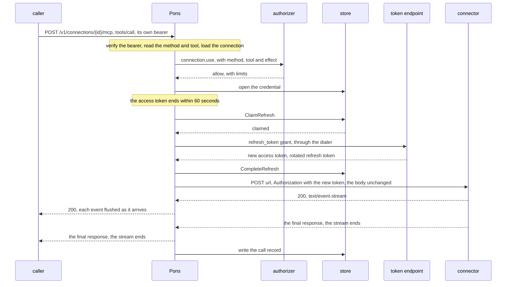

# Carrying a call

## Overview

Each connection is an address, and a caller reaches the connector
through it. The caller presents its own token. Pons verifies it, asks
whether this caller may use this connection for the tool the request
names, adds the connection's credential, forwards the request, and
streams the answer back unread. This spec fixes the address, the order
of the steps, what is read from a request, which headers pass each
way, where the credential goes, what happens when the connector
refuses it, how time and load are bounded, and what is recorded. It
also fixes the probe, the same forwarder sending a request of its own
to try a key. Protocol statements follow the transport of the Model
Context Protocol, revision 2026-07-28, and the authorization rules it
gives a client.

## Current state

Nothing is built. Two designs in sibling projects are the precedent. A
model gateway seals each provider's credential and opens it only to
forward one call, which is the custody here. A sandbox control plane's
egress gateway places a secret in the header its owner named, toward
the hosts its owner named, and never rewrites a framing header, which
is where the credential's place and the header rules come from. Neither
forwards this protocol, so what is read from a request is new.

## Design

### The address

A connection's `address` ([[002-objects]]) is
`{PONS_PUBLIC_URL}{base}/connections/{id}/mcp`, a Model Context
Protocol server over streamable HTTP. A caller sends it what it would
send the connector, with its own bearer token in `Authorization`, and
receives what the connector answers. Pons forwards to the connector's
`url` exactly as the catalog writes it: the path and query of the
caller's request are not appended.

The current revision has one method, `POST`, one JSON-RPC message per
request. Revisions 2025-03-26 through 2025-11-25 also used `GET`, to
open a stream, and `DELETE`, to end a session. The address takes all
three ([[003-api]]) and forwards each unchanged, so a caller and a
connector of either revision meet through it. A connector that speaks
only the current revision answers `GET` and `DELETE` with `405`, and
that status passes on as the connector's.

### One request

In order. The first failing step answers, and nothing after it runs.

1. **The origin.** A request with an `Origin` header whose origin is
   not the origin of an entry of `PONS_RETURN_URLS` is `403 forbidden`,
   as the transport requires of a server against DNS rebinding.
2. **The caller.** The bearer is verified
   ([[004-identity-and-authorization]]): `401 missing_token` or `401
   invalid_token`. A subject with `PONS_MAX_INFLIGHT_PER_SUBJECT`
   requests in flight, or a process with `PONS_MAX_INFLIGHT`, is `429
   rate_limited` before the body is read.
3. **The body**, for a `POST`. It is read up to
   `PONS_MAX_REQUEST_BYTES`, 4 MiB by default; a `Content-Length`
   above it is refused before a byte is read, and a body that runs past
   it is `413 request_too_large`. It is parsed only far enough to learn
   the protocol method and, for a tool call, the tool's name (below).
4. **The connection** is loaded. A miss is `404
   connection_not_found`.
5. **The effect** of a tool call, from the connector's marks
   ([[006-catalog]]).
6. **The question.** `connection.use` is asked with the method, and
   the tool and the effect when the request names a tool. A deny is
   `404 connection_not_found`.
7. **The kind.** A connection whose connector is not of kind `mcp` is
   `409 wrong_kind`.
8. **The allow's limits** ([[004-identity-and-authorization]]). A
   `tools/call` whose effect is `write` under `ReadOnly`, of a tool
   outside `Tools`, or of a tool the connector marks hidden is `403
   forbidden` with `details.field` `tool`. A caller past its
   `CallsPerMinute`, or a connection at its limit of requests in
   flight, is `429 rate_limited`.
9. **The state.** A connection `connected`, or `pending` with the
   credential it had before a reconnect and no `reason`
   ([[002-objects]]), is served. A connection whose connector left the
   catalog is `409 connection_not_connected` with `details.reason`
   `connector_removed` ([[006-catalog]]). Any other is `409
   connection_not_connected` with `details.state`.
10. **The credential** is opened ([[005-store-and-sealing]]) and, when
    it is within 60 seconds of its expiry, refreshed first
    ([[007-sign-in]]).
11. **The request is forwarded** through the dialer
    ([[009-outbound-requests]]), with the headers and the credential
    below.
12. **The answer is streamed back**, below.
13. **The record** is written ([[010-records-and-observability]]).

The body is read before the connection is looked up, and the kind is
checked after the question, so a caller who may not use a connection
receives `404` for every request to it and nothing tells it that the
id exists. One question is asked per request.

### What is read from a request

The transport puts one JSON-RPC request or notification in the body of
each `POST`, and the body is the source of truth for what it asks.
Pons decides on the body and never on a header.

- The body is one JSON object, or the request is `400
  invalid_request`.
- `method` is read, and for `tools/call` also `params.name`, which must
  be a string that is not empty. Keys are matched by exact case. A
  second `method`, `params` or `params.name` key is `400
  invalid_request`, so Pons and the connector cannot read two different
  calls from one body.
- Nothing else is decoded. Arguments, `_meta` and the id are scanned
  only as far as the JSON grammar needs and pass unread.
- The transport mirrors the method into `Mcp-Method` and, for a tool
  call, the tool's name into `Mcp-Name`. When present, `Mcp-Method` is
  compared with `method` and, for `tools/call`, `Mcp-Name` with
  `params.name`, after decoding the `=?base64?...?=` form the transport
  defines for a value that is not plain ASCII. A mismatch is `400
  invalid_request`; the transport has an intermediary answer one with
  an HTTP error.
- The body is forwarded byte for byte.

| The request | `method` asked and recorded | `tool` and effect |
|---|---|---|
| `POST` of `tools/call` | `tools/call` | `params.name`, and `read` when a `read_only` glob matches it, `write` otherwise |
| `POST` of any other request or notification | its `method` | none |
| `POST` of a message with no `method`, a reply to a request the server sent, which only the earlier revisions allow | empty | none |
| `GET` or `DELETE`, of the earlier revisions | `GET` or `DELETE` | none |

`ReadOnly` and `Tools` bind `tools/call` alone
([[004-identity-and-authorization]]). A server's own hints about a
tool are not read ([[006-catalog]]). A server of the current revision
that needs input from the client puts its questions in a result, and
the client sends the original request again with the answers. That
second request is another `tools/call`, asked about and recorded like
the first.

### Headers toward the connector

Only the protocol's own headers pass:

| Header | Why it passes |
|---|---|
| `Accept`, `Content-Type` | content negotiation; the transport has a client accept both `application/json` and `text/event-stream` |
| `MCP-Protocol-Version` | the protocol version, which the current revision requires on every `POST` |
| `Mcp-Method`, `Mcp-Name` | the method and name the current revision mirrors from the body |
| `Mcp-Param-{Name}` | tool arguments a server asked to have mirrored; the transport has an intermediary forward them |
| `Mcp-Session-Id`, `Last-Event-ID` | the session and the resumed stream of the earlier revisions |

Everything else is removed, and these by name: the caller's
`Authorization`, `Cookie` and `Origin`; forwarding headers
(`Forwarded`, `X-Forwarded-*`, `X-Real-IP`, `Via`); hop-by-hop headers
(`Connection`, any header it names, `Keep-Alive`,
`Proxy-Authorization`, `Proxy-Connection`, `TE`, `Trailer`,
`Transfer-Encoding`, `Upgrade`); and a header of the name the
connector takes its credential in, so a caller cannot supply one.

Pons adds `User-Agent: pons/<version>`. The carrier never writes the
credential into the request itself: it hands it to the dialer as a
`dial.Secret` with its place and a matcher of the connector's `hosts`,
and the dialer writes it in last, toward a matching host only
([[009-outbound-requests]]).

| `auth` | The credential's place |
|---|---|
| `oauth` | `Authorization: Bearer <access token>`, the header the protocol has a client use, and never the query |
| `client_credentials` | `Authorization: Bearer <minted token>` ([[007-sign-in]]) |
| `token` | the connector's `inject.header`, valued by `inject.format` with the key in place of `{value}` ([[006-catalog]]) |
| `none` | nothing |

### The answer

The connector's status and body pass as they are. A body of
`text/event-stream` is written to the caller as each read returns and
flushed at once, so no event waits in a buffer, and Pons adds
`X-Accel-Buffering: no`, which the transport has a server send so a
proxy between does not hold the stream. Only `Content-Type`,
`Cache-Control`, `Retry-After` and, for the earlier revisions,
`Mcp-Session-Id` pass back. `WWW-Authenticate`, `Set-Cookie` and
`Location` never do: a caller that saw the connector's challenge would
try to sign in at the connector itself, around Pons, for a credential
it is never to hold.

A `3xx` is `502 connector_unavailable`. The carrier follows no
redirect, since the address a connector names is not one the catalog
named.

What the server sends passes through unread: notifications, a result
that asks the client for input, and, in the earlier revisions, requests
of its own on a stream. Pons parses no answer, changes none and adds
nothing to one ([[001-architecture]], invariant 8). The tool marks
reach a caller on the connection object ([[002-objects]]), never inside
an answer.

An error Pons raises has the body of [[003-api]]. A status the
connector answered passes as it is.

### When the connector refuses the credential

A `401` from the connector, before anything has been sent to the
caller:

| `auth` | What Pons does |
|---|---|
| `oauth` with a refresh token | one refresh ([[007-sign-in]]) and one more attempt. A second `401` moves the connection to `needs_reconnect` with reason `revoked` and answers `409 connection_not_connected` |
| `oauth` without one | `needs_reconnect` with reason `revoked`, and `409` |
| `client_credentials` | one new token and one more attempt. A second `401` is `needs_reconnect` with reason `credential_refused`, and `409` |
| `token` | `needs_reconnect` with reason `credential_refused`, and `409`. No retry |
| `none` | the `401` passes on, less its `WWW-Authenticate`. Nothing changes |

A connection in `pending` for a reconnect is not moved by a refusal: it
keeps its state and takes the reason, so its confirm still applies, and
it answers `409` from then on ([[002-objects]]).

The attempt can always be made again: a `POST` body is held in memory,
and a `GET` or `DELETE` has none. A refresh refused with `invalid_grant`
is `409` with reason `refresh_refused`, and any other refresh failure
`502 connector_unavailable` ([[007-sign-in]]).

For an `oauth` connection, a `403` whose `WWW-Authenticate` carries
`error="insufficient_scope"` is the protocol's scope challenge
(RFC 6750, section 3.1). Pons answers `409
connection_not_connected` with `details.reason` `scope_insufficient`,
`details.scopes` the challenge's `scope` split on spaces, and
`details.state` the connection's, which does not change. A caller that
speaks for a person offers a reconnect with those scopes, and the new
sign-in asks for the union of the old and the new ([[007-sign-in]]).
Any other `403` passes on as it is.

### Sessions

The current revision has no protocol session, and Pons holds none of
its own. For a connector of an earlier revision, `Mcp-Session-Id`
passes both ways and the session lives between the caller and the
connector. Pons keeps nothing between requests, so any replica serves
any request, of a session or not.

### Time and load

| Bound | Value | Past it |
|---|---|---|
| connecting to the connector | 10 seconds | `504 connector_timeout` |
| the first response header | `PONS_CALL_HEADER_TIMEOUT`, `30s` by default | `504 connector_timeout` |
| between two reads of a body | `PONS_STREAM_IDLE_TIMEOUT`, `5m` by default | the answer is cut and the record says `timeout` |
| requests in flight per connection per process | 16 | `429 rate_limited`, `Retry-After: 1` |
| requests in flight per subject per process | `PONS_MAX_INFLIGHT_PER_SUBJECT`, 32 by default | `429 rate_limited`, `Retry-After: 1` |
| requests in flight per process | `PONS_MAX_INFLIGHT`, 1024 by default | `429 rate_limited`, `Retry-After: 1` |

A tool that works longer than the header timeout answers with a
stream, whose headers arrive first, or the operator raises the timeout.
A failure to connect other than a timeout, and an address the dialer
refuses, is `502 connector_unavailable`.

A caller that goes away cancels the request to the connector. The
transport makes the close of a response stream the cancellation of
that request, so the connector stops its work. A `subscriptions/listen`
stream holds one of the 16 places for its life. The transport
encourages a server to send keep-alive comments on it; one that sends
none is cut after the idle timeout, and the caller opens it again.

The places are `latere.ai/x/pkg/semaphore`s, of 16 per connection, of
`PONS_MAX_INFLIGHT_PER_SUBJECT` per subject and of `PONS_MAX_INFLIGHT`
for the process, each taken with `Acquire(ctx, 0)` so a request never
queues. The last two hold whatever an allow says
([[004-identity-and-authorization]]). `CallsPerMinute` is a
`latere.ai/x/pkg/ratelimit` bucket keyed by caller and connection. All
are per process: with n replicas a caller may make up to n times any of
these limits. Every request to the address counts against
`CallsPerMinute`.

### The probe

The probe is this forwarder sending requests of its own, with no
caller. It tries a pasted key before it is stored ([[003-api]],
[[007-sign-in]]), with the key in its place, and makes the first
request of discovery, with no credential ([[007-sign-in]]).

1. A `tools/list` of the current revision: a `POST` to `url` with
   `Accept: application/json, text/event-stream`, `Content-Type:
   application/json`, `MCP-Protocol-Version: 2026-07-28`, `Mcp-Method:
   tools/list`, and a body whose `_meta` carries the protocol version,
   a `clientInfo` of `pons` and its version, and empty client
   capabilities.
2. A `400` whose body is not a JSON-RPC error of the current revision
   marks a connector of an earlier revision, as the transport's
   backward compatibility describes; a `404` or a `405` does not. The
   probe then makes
   that revision's `initialize` handshake, lists the tools in the
   session it opens, and ends the session with `DELETE`.
3. The outcome is read from the status: `2xx` accepts the key, `401` or
   `403` refuses it, and anything else, or no answer, is a connector
   that cannot be reached. Discovery reads the `401` and its challenge.
   The list of tools is not read.

The probe's answers reach no caller and are kept nowhere.

### What is recorded

One record per request whose connection was found at step 4, written
when the answer ends ([[010-records-and-observability]]). A request
refused before it, for its origin, its token, a bound of step 2 or its
body, named no call of a connection and is counted, not recorded. So is
a failure of Pons's own, a `500` or `503` it raises itself. A `502` or
`504` about the connector is recorded, as `upstream_error` or
`timeout`. A denied call writes at most one record per subject and
connection per minute on each replica; the rest are counted in
`pons.calls` and not recorded.

| How the request ended | `outcome` |
|---|---|
| the connector's answer, whatever its status, carried to the end | `ok` |
| a refusal at steps 6 to 8 | `denied` |
| `409 connection_not_connected` at step 9 | `not_connected` |
| a `401` that moved the connection, a scope challenge, a refresh refused | `upstream_refused` |
| a `3xx`, a failure or refusal of the dialer, a refresh that failed otherwise, an answer broken off | `upstream_error` |
| a timeout of the table above | `timeout` |
| the caller went away | `canceled` |

`bytes_in` is the body's size and `bytes_out` what was streamed. The
`status` is the connector's last, when it answered. No header, query,
argument or result is kept.

### A call that needs a refresh

## Not in this spec

The verification, the question and the limits of an allow
([[004-identity-and-authorization]]); the refresh and the sign-in
([[007-sign-in]]); what the dialer refuses and its limits
([[009-outbound-requests]]); the record's retention, the metrics and
traces ([[010-records-and-observability]]); a forwarding address of
kind `http` ([[014-http-forwarding]]). Pons serves no protected
resource metadata of its own, so a generic client cannot sign in to
Pons through this address: a caller arrives with a token.

## Acceptance criteria

| Criterion | Test that proves it |
|---|---|
| Only the headers of the table reach the connector: the caller's `Authorization`, cookies, `Origin`, forwarding and hop-by-hop headers and a header named like the credential's never do, and the credential is in its place with `User-Agent: pons/<version>` | `carry.TestRequestHeaders`, one case per `auth` |
| The status and the body pass byte for byte, only the listed response headers pass, and `WWW-Authenticate`, `Set-Cookie` and `Location` never do | `carry.TestAnswerPassesUnchanged`, `carry.TestResponseHeaders` |
| A caller receives each event of a stream before the connector sends the next | `carry.TestStreamIsFlushedPerEvent` |
| A `3xx` is `502 connector_unavailable` and the redirect is not followed | `TestCarrierFollowsNoRedirect` |
| A body over the limit is `413` before it is read; a body that is not one object, a duplicate or differently cased key, or a mirrored header that differs from the body is `400`; arguments are never decoded | `carry.TestParseOnlyTheMethodAndTool`, `carry.FuzzParse` |
| A caller that may not use a connection gets `404 connection_not_found` for every request to it, a wrong kind included, and an oversized body is `413` whether the id exists or not; one question is asked per request | `carry.TestNothingTellsAnIdBeforeTheQuestion`, `TestADenyDoesNotConfirmAnId` |
| The effect follows the marks; a writing tool under `ReadOnly`, a tool outside `Tools` and a hidden tool are `403`, a `tools/list` under `ReadOnly` passes, and the limit per minute and the seventeenth request in flight on one connection are `429`; a refused call opens no credential | `carry.TestLimitsOfAnAllow`, `carry.TestALimitRefusesBeforeTheCredential`, `TestAConnectionsConcurrencyIsBounded` |
| A subject past `PONS_MAX_INFLIGHT_PER_SUBJECT` requests in flight, across its connections, and a process past `PONS_MAX_INFLIGHT` are `429` before the body is read, with no authorizer and under an allow that names no limit | `TestACallersConcurrencyIsBounded` |
| A `pending` connection being reconnected is served with its old credential, and a connection whose connector left the catalog answers `409` with `connector_removed` | `TestReconnectKeepsServing`, `TestRemovedConnectorKeepsItsConnections` |
| A `401` gets one refresh and one more attempt, a second moves the connection to `needs_reconnect` with `revoked`, and a pasted key moves at once with `credential_refused` | `carry.TestConnectorRefusesTheCredential` |
| A scope challenge is `409` with `scope_insufficient` and the scopes, and the connection's state does not change | `carry.TestInsufficientScope` |
| A request with a foreign `Origin` is `403` | `carry.TestOriginIsChecked` |
| A session of an earlier revision is served across two replicas, its header passing both ways, and `GET` and `DELETE` reach the connector unchanged | `TestAnyReplicaServesASession`, e2e tier |
| The header timeout is `504`, an idle stream is cut with outcome `timeout`, and a caller that goes away cancels the connector's request | `carry.TestTimeoutsAndCancel` |
| The probe accepts a key with a `tools/list`, falls back to the handshake for a stub of an earlier revision, and refuses a key the stub answers `401` | `carry.TestProbe` |
| Each request whose connection was found at step 4 writes one record with its method, tool, effect, outcome, status and sizes, and none holds an argument or a result; a `500` or `503` Pons raises leaves none, and a `502` or `504` about the connector leaves one | `TestEveryCallIsRecorded` |
| Of many denied calls of one subject to one connection within a minute, one is recorded and every one is counted | `TestDeniedCallsAreRecordedOncePerMinute` |
| A call with an expiring token refreshes once and streams its answer through the stub connector | `TestCallThatNeedsARefresh`, e2e tier |
| A canary credential appears in no answer, header, record or log line of the address | `TestNoCredentialLeavesButTowardItsConnector` |
