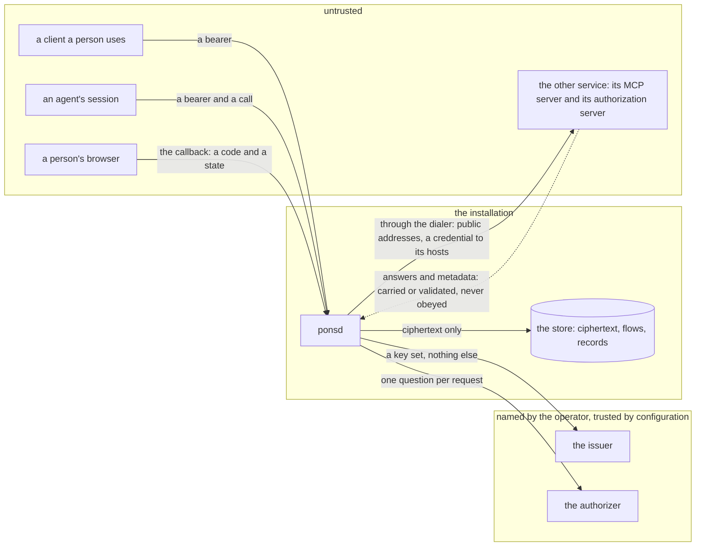

# Security and threat model

## Overview

Pons holds other people's credentials, signs people in to services it
does not run, and connects to addresses it did not choose, for callers
that are often an agent's session acting on text nobody reviewed. This
spec names what is worth taking, who would take it, and where the
boundaries are. For every attacker it states what they can do, the
defense, the spec that owns the defense and the test that holds it. A
defense without a test is a claim, so a test reads this file and holds
every test it names to one that exists.

It designs no mechanism of its own. Each defense is another spec's, and
this one is the place a reviewer checks that none is missing.

## Current state

Nothing is built.

Two threat models in sibling projects are the precedent, of a sandbox
control plane and of an object store: every control is a row with the
spec that owns it and the test that proves it, and a test holds the
table to the tree. The second one's first draft named tests that did
not exist, which is why the cross-check is part of this spec from its
first version. The protocol side is taken from the security
considerations of the Model Context Protocol authorization
specification, revision 2026-07-28, and its security best practices.

## Design

### What is protected

| Asset | Where it lives | What holding it is worth |
|---|---|---|
| credentials: access tokens, refresh tokens, pasted keys, a client's secret for its own grant | Postgres, as ciphertext; a process's memory, opened, for the time of a call | acting as a person at the other service |
| the sealing keys | `PONS_SEALING_KEYS`, in the process's configuration | every credential at once |
| clients' secrets the operator registered, and the ones a registration issued | the operator's variables or files, which the catalog names by reference; Postgres, sealed | signing people in as this installation |
| a sign-in in progress: `state`, the verifier, the tokens not yet confirmed, the finish code | the flow's row, sealed or hashed | one connection, for a few minutes |
| the record of who called what | the call records | the only account of what a session did with a connection |
| a caller's own token | a request's header, for the time of that request | acting as that caller at Pons |
| the installation's own network | around the process | what a request made from inside can reach |

### Trust boundaries

Four boundaries. Between a caller and Pons the control is the verifier
and the authorizer. Between Pons and the store it is the sealing: the
store is trusted to keep rows and is not trusted with what they open
to. Between Pons and the issuer and the authorizer it is configuration:
Pons trusts them because the operator named them. Between Pons and the
other service it is the dialer and the rules of the sign-in, and
nothing that service says is trusted: not its metadata, not its
redirects, not its answers.

### Who attacks

| # | Who | What they can do | The defense | Spec | Test |
|---|---|---|---|---|---|
| 1 | a caller with a valid token of another owner | present a token a listed issuer signed, and name any connection's id | every route verifies the token and its audience, then asks the authorizer about this caller, this action and this connection before it reads or acts; with no authorizer an owner reaches their own connections alone; a deny on a stored object answers as its absence, so an id is not confirmed. An id is ordered by time and is no secret: the question is the defense | 004, 003 | `TestADenyDoesNotConfirmAnId`, `TestTheOwnerPolicyThroughTheAPI`, `TestAnotherOwnersTokenReachesNothing` |
| 2 | an agent's session that was tricked by content it read | call every tool its allow admits, with any arguments, as often as its limits allow | it can never obtain a credential: no route returns one, and the credential is added inside Pons after the request is read and goes toward the connector's hosts alone. What it can do is bounded by the effect mark of each tool, where a tool no mark names counts as one that changes something, by an allow's `ReadOnly` and `Tools` limits, which refuse a call before it leaves, and by the record, which names the session, the tool and the effect of every call Pons carries | 004, 006, 008, 010 | `TestATrickedSessionObtainsNoCredential`, `carry.TestALimitRefusesBeforeTheCredential`, `TestEachMemberOfAnAllowChangesTheOutcome` |
| 3 | a hostile connector | answer anything to a call, and publish any metadata | an answer that asks for the caller's token gets none: the caller's token is removed before the call leaves and a `WWW-Authenticate` is never forwarded. A redirect is not followed. A cookie is neither stored nor passed on. Headers end at 64 KiB, an answer is streamed and never held whole, a stream that goes silent ends at its idle time, and one that never ends holds one bounded slot. Metadata that points at an internal address is refused at connect time, and the connector's credential goes to its own hosts, so it cannot draw another connector's | 008, 009, 007 | `TestAConnectorsChallengeReachesNoCaller`, `TestCarrierFollowsNoRedirect`, `TestAConnectorSetsNoCookie`, `TestAnAnswerIsBounded`, `TestMetadataCannotPointInside` |
| 4 | a person who adds an address that aims at the installation's own network | add a connector with any URL, and answer for a name they own differently each time it is asked | three layers: the host rule when the address is written, the address check on the address the socket uses, and the installation's network rule. Port 443 alone. The refusal names the rule and never an address, so it is no map of the inside | 009, 006, 011 | `TestAnAddedAddressCannotAimInside`, `dial.TestConnectsToTheAddressItChecked`, `TestExampleDeniesPrivateEgress` |
| 5 | someone who sends another person the sign-in link | start a connection of their own and have a victim finish its sign-in with the victim's account | the callback connects nothing: the tokens stay sealed with the flow, and the finish code goes to the browser that finished. The connection becomes usable only when a caller who may act for its owner confirms with that code. The victim's client does not confirm a connection its session did not start, a caller acting for the victim is denied on the sender's connection, and the sender never holds the code. The sender cannot choose where the code goes: `return_to` is held to the exact URLs and the path prefixes of `PONS_RETURN_URLS`, not to their origins (RFC 9700, section 4.1.3). An unconfirmed flow expires and its tokens are discarded | 001 invariant 7, 007, 003 | `TestALinkSentToSomeoneElseConnectsNothing`, `TestTokensWaitForTheConfirm`, `TestASenderCannotChooseWhereTheCodeGoes` |
| 6 | a network attacker at the callback | call the callback with any code and `state`, replay one they saw, or inject a code of their own | `state` is random, kept as a hash, matches one live flow once and expires with it. The proof key's verifier is sealed with the flow and sent to the recorded token endpoint alone, so a stolen code redeems nowhere and an injected one fails the exchange. The issuer of the answer is compared with the one recorded before the person was sent away, before the code goes to any endpoint. A `state` that matches no flow is answered with a page and no redirect | 007, 003 | `signin.TestCallbackIsOnce`, `signin.TestAuthorizationRequest`, `signin.TestIssuerValidation` |
| 7 | two authorization servers mixed up, and a token used at a server it was not issued for | run one connector and its authorization server, have its metadata name an honest service's endpoints, or send the person on to an honest server and receive its answer at the one callback | the issuer and the endpoints are recorded from validated metadata before the redirect, and the code goes to the recorded token endpoint alone. An answer without `iss` is accepted only from an authorization server the catalog names; a connector a person adds is accepted only when its server says it sends `iss`, so a hostile server that forwards the person to an honest one gets no code (RFC 9700, section 4.4). A connection keeps the issuer of its first confirm, and a reconnect at another is refused. A connector a person adds is named to its server by a client metadata document of its own, so a consent given to another connector is not reused. Where the connector takes it, the `resource` member of both requests names the connector, so a token is issued for that connector. The host binding sends an access token to its connector's hosts and a refresh token to the token and revocation endpoints recorded with it, and nowhere else | 007, 009 | `TestATokenStaysWithItsAuthorizationServer`, `signin.TestIssuerValidation`, `signin.TestAMixUpWithoutIssIsRefused`, `signin.TestReconnectKeepsItsIssuer`, `dial.TestSecretIsBoundToItsHosts` |
| 8 | a reader of the database or of a backup, and a writer of it | read every row, copy one row's columns into another, and rewrite a column kept in the clear | every credential, verifier and registered secret is ciphertext under a key the database never holds, and `state` and the finish code are hashes. A ciphertext is bound to its row and does not open in another. A credential is also bound to the issuer, the token endpoint and the revocation endpoint recorded with it and to an added connector's `url`, so a writer who rewrites one of those columns makes the credential fail to open rather than go to a new place. What a reader does learn is who connected what, the account names, the scopes and the call records | 005 | `TestNoPlaintextAtRest`, `store.TestACopiedCiphertextDoesNotOpen`, `store.TestRewrittenEndpointDoesNotOpen` |
| 9 | a reader of logs, traces and records | read everything Pons emits | a log line, a span, a metric and a record hold identifiers, names, sizes and outcomes: no header, argument, result or query string. An error carries no part of a token, an unclassified one is answered as `internal` with its text logged, and a setting that does not parse is named without its value. The canary test searches all of it | 010, 001 invariants 1 and 9 | `TestNoCredentialLeavesButTowardItsConnector` |
| 10 | a replayed finish code, and a `return_to` that points elsewhere | read the redirect that carried the code from a history or a referrer; start a sign-in whose `return_to` is a site of their own | the code is used once, is good for 2 minutes, is kept as a hash and belongs to one flow; a wrong one spends the flow; and the confirm still needs a caller who may act for the owner. A `return_to` is held to `PONS_RETURN_URLS` when the flow is made, and the callback redirects to the flow's own and to no other address | 003, 007 | `TestConfirmIsOnceAndTimed`, `TestReturnToIsHeldToItsURLs` |
| 11 | exhaustion | send large bodies, open many streams, call fast, create many connections or connectors, or be a connector that answers slowly | a request ends at `PONS_MAX_REQUEST_BYTES`, a connector that sends no headers at `PONS_CALL_HEADER_TIMEOUT`, a silent stream at `PONS_STREAM_IDLE_TIMEOUT`, and a fetch of the sign-in at the dialer's bounds. Calls in flight are bounded per connection, so a slow connector holds its own connection's slots and no other's, and per subject and per process by `PONS_MAX_INFLIGHT_PER_SUBJECT` and `PONS_MAX_INFLIGHT`. With no authorizer or under any allow, an owner holds at most `PONS_MAX_CONNECTIONS_PER_OWNER` connections, and a subject makes at most `PONS_CREATES_PER_MINUTE` adds, connects and reconnects, each of which fetches discovery documents; an allow's limits only narrow these. An allow's `CallsPerMinute` is `429 rate_limited` past it. A denied call writes at most one record per subject and connection per minute, and the rest are counted | 008, 004, 009 | `TestSizesAndTimeoutsEndACall`, `TestAConnectionsConcurrencyIsBounded`, `TestACallersConcurrencyIsBounded`, `TestLimitsHoldWithNoAuthorizer`, `TestDeniedCallsAreRecordedOncePerMinute`, `TestEachMemberOfAnAllowChangesTheOutcome`, `dial.TestLimits` |

Forwarding and git ([[014-http-forwarding]]) add two more:

| # | Who | What they can do | The defense | Spec | Test |
|---|---|---|---|---|---|
| 12 | a caller that aims a forwarded path elsewhere | send a path with dot segments, encoded slashes or a host-like first segment, or follow a redirect | the path is refused before it is joined, the joined URL keeps the connector's host, a `3xx` elsewhere is `502`, and the dialer's host binding is the second check | [[014-http-forwarding]], [[009-outbound-requests]] | `carry.TestAForwardedPathStaysOnItsConnector`, `carry.TestARedirectStaysOnItsConnector` |
| 13 | an agent's session that pushes where a person should | push to the default branch, delete a ref, or push many refs at once | the commands are read before the pack and every ref is held to the allow's `Refs`; a push the allow does not cover is refused before a byte of the pack leaves | [[014-http-forwarding]], [[004-identity-and-authorization]] | `carry.TestAPushIsHeldToItsRefs` |

Row 2 has a limit that is said plainly. Content inside an answer is the
caller's concern. Pons carries an answer unread ([[001-architecture]],
invariant 8): it removes nothing from one, adds nothing to one and
vouches for none of it. A tool's answer that holds an instruction
reaches the session that asked for it, and what that session then does
is bounded by what it may call, not by anything Pons reads.

### The protocol's own considerations

Pons is a client of the other service's authorization server and a
protected resource for its own callers. Each consideration of the
authorization specification lands on one of the two sides:

| Consideration | Where Pons stands | Spec |
|---|---|---|
| token audience binding | as a client, `resource` is sent in the authorization and the token request, always for a connector found through its metadata; as a resource, a caller's token must carry `PONS_OIDC_AUDIENCE` | [[007-sign-in]], [[004-identity-and-authorization]] |
| token theft | tokens are sealed at rest, a refresh token is traded by one writer and its rotation is kept | [[005-store-and-sealing]], [[007-sign-in]] |
| communication security | every outbound address is `https`, and so is `PONS_PUBLIC_URL`, which the redirect address is made from, outside the memory store | [[009-outbound-requests]], [[011-distribution]] |
| authorization code protection | the proof key with `S256`, and a server whose metadata lacks `S256` is `sign_in_unsupported` | [[007-sign-in]] |
| mix-up attacks | row 7: the recorded issuer, the check of `iss`, and an answer without `iss` accepted only from a server the catalog names | [[007-sign-in]] |
| open redirection | `state` is verified, one exact redirect address is registered, and `return_to` is held to exact URLs and path prefixes | [[007-sign-in]], [[003-api]] |
| client metadata documents | Pons serves its own at one fixed address for catalog connectors and one per connector a person added, each with one `https` redirect address and no loopback one | [[007-sign-in]] |
| confused deputy | Pons registers no client of its own callers and issues no token; the consent that matters is the owner's confirmation, row 5 | [[007-sign-in]] |
| token passthrough | a caller's token is verified for Pons and removed; the token sent on is the one the other service issued for that connector | [[008-carrying-a-call]] |
| request forgery during discovery | rows 3 and 4: every address a document names goes through the dialer | [[009-outbound-requests]] |

### What is not defended

- **An operator who holds the sealing keys.** They open every
  credential. Sealing defends against a reader of the database who
  lacks the keys, not against whoever runs the installation.
- **A service that misuses the access a person granted it.** Pons
  carries calls to the service a person chose. What that service does
  with the person's account is the service's.
- **An authorizer that answers wrongly,** or an issuer that signs a
  token for the wrong subject. Pons refuses when no decision arrives.
  It follows the decision that does.
- **A compromised host.** The process's memory holds the sealing keys
  and the access tokens it has opened.
- **What a model does with an answer it read.** Row 2 bounds what a
  tricked session can do through Pons, not what it does elsewhere, and
  not what it tells the person it works for.
- **A client that gives a finish code away,** or a caller's token taken
  from the caller. Pons cannot tell the holder from the owner.
- **A catalog written wrongly:** hosts wider than the service's own, or
  a tool that changes something marked as one that only reads.
- **An authorization server that ignores `resource`** and issues a
  token valid at another resource. Pons names the connector in every
  request and cannot see what the server bound the token to.
- **Denial of service beyond row 11.**

### Reporting

`SECURITY.md` is written by the scaffold ([[011-distribution]]). It
names a private channel for a report, asks that no public issue be
opened for one, and says when a reporter hears back. It then lists what
the project commits to, each commitment one row of the table above in a
reader's words, and what is not defended, as the list above. A
commitment whose test is not written yet is not listed. A test reads
both files and holds each commitment to a row.

## Not in this spec

The mechanisms themselves: verification and the question
([[004-identity-and-authorization]]), sealing
([[005-store-and-sealing]]), the sign-in ([[007-sign-in]]), the carrier
([[008-carrying-a-call]]), the dialer ([[009-outbound-requests]]), what
is logged ([[010-records-and-observability]]). The container's
confinement and the network rule ([[011-distribution]]).

## Acceptance criteria

| Criterion | Test that proves it |
|---|---|
| Every test the table of attackers names is one `go test -list` finds in the module, or is on an exact list of tests not yet written, which only shrinks; and every test a row names is named by the acceptance criteria of a spec in its Spec cell or of this one | `TestThreatModelTestsExist`, reading this file and the specs it names |
| Every commitment of `SECURITY.md` is a row of the table, and the file names a private channel | `TestSecurityPolicyMatchesTheModel`, reading both files |
| With another owner's token, a read, a rename, a confirm, a reconnect, a delete, a list of calls and a call each answer as for a missing connection, and nothing changes | `TestAnotherOwnersTokenReachesNothing` |
| A session that calls every tool of the stub connector with arguments that ask for the credential receives it in no answer, header or error | `TestATrickedSessionObtainsNoCredential` |
| The stub connector's challenge, redirect, cookie, oversized headers, silent stream and endless stream each end as row 3 says, and the caller's token reaches the connector in none of them | `TestAConnectorsChallengeReachesNoCaller`, `TestCarrierFollowsNoRedirect`, `TestAConnectorSetsNoCookie`, `TestAnAnswerIsBounded` |
| Metadata that names an inside address, directly, by a name that resolves to one, or by a redirect, ends the sign-in with `connector_unreachable` and no connection to that address | `TestMetadataCannotPointInside` |
| An added connector whose name resolves to a private address is refused with the rule's name, and the same request with the address rule off reaches the stub | `TestAnAddedAddressCannotAimInside` |
| A hostile authorization server whose metadata names the honest stub's token endpoint receives no code, no verifier and no token of the honest one | `TestATokenStaysWithItsAuthorizationServer` |
| An oversized request, a connector that sends no headers and a silent stream each end with their code within their bound, and calls past a connection's bound are refused without touching another connection | `TestSizesAndTimeoutsEndACall`, `TestAConnectionsConcurrencyIsBounded` |
