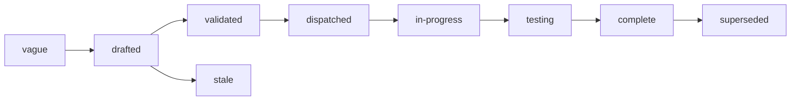

# Specs

Design specs for Pons, a service that keeps a person's connections to
other services and carries every call to them: the objects a
connection is made of, the API a client and a caller code against, the
sign-in with the other service, the store that seals each credential,
the address a caller uses, and the one dialer every outbound request
goes through. One spec covers one component. Each states the problem,
the design with enough precision to build from, and acceptance criteria
that are testable statements. Spec 001 fixes the architecture every
other spec assumes; read it first. Spec 003 is the contract a caller
codes against. Specs 005, 007, 008 and 009 are the core of the system:
custody, the sign-in, the call, and what may be reached.

## Layout

Flat files `specs/NNN-name.md` in one number space with `track: core`
in the frontmatter. Numbers are stable identifiers and are never
reused. Open specs sit here and are the work queue. A terminal spec
moves to `specs/.archive/` keeping its number so `depends_on` paths
still resolve.

Specs 001 to 012 were read as a whole on 2026-10-12 by two readers
working apart, one for security and one for consistency and the
protocol, and were revised from what they found. Specs 013 and 014 were
written after that reading: GitHub, the first connector, carried as git
and its REST API through the forwarding and git addresses of 014. Spec
015 adds Google's Gmail, Calendar and Drive the same way, through their
REST APIs.

v0.1.1, of 2026-10-13, is the first release with an image; v0.1.0
published nothing. Steps 1 to 4 of the build order are built; of step 5
the forwarding and git addresses of 014 with the carrier's steps of 008;
step 6, the sign-in of 007 with GitHub's habits of 013, for catalog
connectors; and step 7 for GitHub, the whole path against the stubs and,
on 2026-10-13, against the real GitHub, as 013's Outcome records. The
release workflow of 011 is built, and the repository is public since
that check.

Main carries, after v0.1.1 and for the next release: a connection's
kind and a connector's sent to the authorizer as `connection_kind` and
`connector_kind`; a refused push answered in git's protocol, so git
prints the rule; git's probe before a push larger than its post buffer
forwarded; the forwarding address held to an API's methods; an
`authorize_url` that may carry a query; the Google entries of 015; and
the documentation in `docs/`. What remains is the MCP address of 008
and what waits on it, such as a connector a person adds that signs
people in; the metrics and spans of 010; `deploy/`, the generated
configuration reference, the stub connector and the release workflow's
test of 011; the threat model's own tests of 012; and 015's check
against the real Google.

Specs 013 and 014 are `complete` and archived: every criterion has its
test, and the check against the real GitHub passed. Spec 002 is
`testing`: built, and every one of its criteria has its test. The other
specs are `in-progress`: each says under Implementation status what is
built and which of its criteria wait.

## Index

| # | Spec | Effort | Status | Builds on |
|---|---|---|---|---|
| [001](001-architecture.md) | Architecture: one binary, Postgres for connections and sealed credentials, a sign-in with the other service, and every call carried through | large | in-progress | |
| [002](002-objects.md) | Objects: connector, connection, credential, flow, registration and call record, their fields, states and identifiers | medium | testing | 001 |
| [003](003-api.md) | API: the catalog, connections and their sign-in, the address a caller uses, records, and the errors a caller branches on | large | in-progress | 001, 002 |
| [004](004-identity-and-authorization.md) | Identity and authorization: verifying a caller, the action vocabulary, the question to the authorizer, limits on an allow, the owner policy | medium | in-progress | 001, 003 |
| [005](005-store-and-sealing.md) | Store and sealing: the tables, the two adapters and their one suite, envelope encryption, key rotation | large | in-progress | 001, 002 |
| [006](006-catalog.md) | Catalog: the file an operator writes, the members of each way to give access, a connector a person adds, tool marks | medium | in-progress | 002 |
| [007](007-sign-in.md) | Sign-in: discovery, how Pons identifies itself, the flow and its confirm, the token exchange, refresh by one writer, reconnect | xlarge | in-progress | 002, 003, 005, 006, 009 |
| [008](008-carrying-a-call.md) | Carrying a call: the address, what is forwarded and what is removed, the credential's place, streaming, the tool a request names, failures | xlarge | in-progress | 002, 003, 004, 005, 007, 009 |
| [009](009-outbound-requests.md) | Outbound requests: the one dialer, public addresses only, redirects, limits, and a credential bound to its hosts | large | in-progress | 001 |
| [010](010-records-and-observability.md) | Records and observability: the call record and its retention, metrics, traces, logs that hold no content, the probes | medium | in-progress | 002, 008 |
| [011](011-distribution.md) | Distribution: the repository scaffold, the binary and its images, configuration, the stubs, test tiers, and release | large | in-progress | 001 |
| [012](012-security-and-threat-model.md) | Security and threat model: what is protected, who attacks, each defense and the test that holds it, and what is not defended | medium | in-progress | 001, 005, 007, 008, 009 |
| [013](.archive/013-github-connector.md) | A code host's connector: GitHub through a GitHub App, signed in like any connector, with git and the REST API carried through Pons | medium | complete | 006, 007, 014 |
| [014](.archive/014-http-forwarding.md) | Plain HTTP and git through a connection: a forwarding address and a git address, the credential added, a path held to its connector, and a push held to the refs an allow names | large | complete | 002, 003, 004, 006, 008, 009 |
| [015](015-google-connectors.md) | Google's connectors: Gmail, Google Calendar and Google Drive, each signed in with Google on its own and carried as Google's REST APIs | small | in-progress | 006, 007, 013, 014 |

## Build order

The numbers are identifiers, not the order of work. The order is:

1. **Scaffold** (011): the module, the gate, the stubs.
2. **Identity and the store** (004, 005): a caller is verified and
   asked about, and a credential is sealed and opened, against both
   adapters.
3. **The dialer** (009), before anything reaches an address.
4. **The catalog and a pasted key** (006, 003): a connection made with
   a key and read back.
5. **The call** (014, then 008): a connection used through its
   forwarding and git addresses against the stub API and git host, then
   through its MCP address against the stub connector, with a record
   (010). Forwarding comes first because GitHub, the first connector,
   needs it.
6. **The sign-in** (007, 013): a connection made by signing in at the
   stub authorization server in GitHub's manner, confirmed, refreshed,
   and reconnected.
7. **The whole path** end to end, and the threat model's tests (012).
